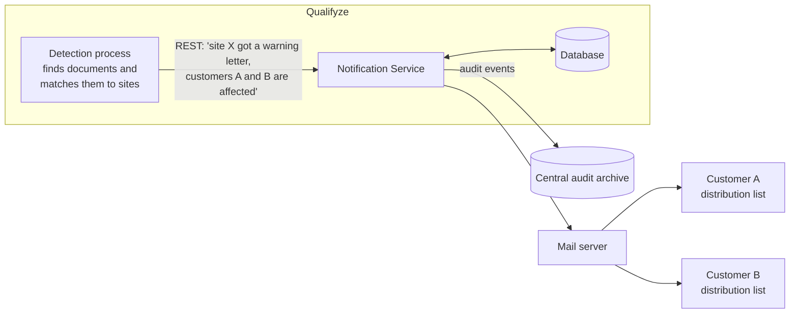

# 1. Overview

## In short

- Qualifyze already detects when a regulator publishes a document about a
  manufacturing site. What is missing is a way to **tell the affected customers**.
- This service receives the event over a REST API, finds each customer's
  distribution list and sends them an e-mail.
- It records everything it does, so that we can prove later who was told what,
  and when.
- It is built so that new channels (Slack, WhatsApp) and new kinds of message can
  be added without rewriting it.

## The problem

Qualifyze customers buy from manufacturing sites around the world. When an
authority such as the FDA, the EMA or the MHRA publishes a **warning letter**, an
**OAI** (Official Action Indicated) or a **non-compliance report** about one of
those sites, the customers need to know quickly.

Qualifyze already finds these documents in public sources and uses AI to match
them to a site. The match is not always certain, so it comes with a
**confidence level** between 0 and 100 %.

## The solution in one picture

1. The detection process calls the service once per event and lists the affected
   customers.
2. The service answers immediately ("received") and does the sending in the
   background.
3. For each customer it reads the **distribution list** (the e-mail addresses
   the customer wants to use) and sends one message to each address.
4. It stores a record of every attempt and sends a copy of every change to the
   central audit archive.

## The message

Every regulatory event produces one line of text:

> Site **Qualifyze Spain**, located at **Passeig de Gracia 19 Barcelona** received a **FDA** **warning letter** on **12 June 2026**. [**80%**]

| Part | Meaning |
|---|---|
| Site name | Full name of the manufacturing site |
| Site address | Main address of the site |
| Authority | Who published the document (FDA, EMA, MHRA, …) |
| Document type | Warning letter, OAI or non-compliance report |
| Date | When the document was issued |
| [Confidence] | How sure the AI matching is that the document belongs to this site |

## Scope

| In scope | Out of scope |
|---|---|
| Receiving events through a REST API | Detecting events in public sources (already exists) |
| Managing each customer's distribution list | Deciding which customers are affected (the caller sends that) |
| Sending e-mails | A user interface |
| Recording every send, failure and change | Storing the long-term audit archive (a central service does that) |
| Metrics on usage and performance | Authentication of callers (handled by the service mesh) |
| Being ready for more channels and message types | Building a Slack or WhatsApp sender now |

## Expected volume

Between 1 and 5 events per week, each affecting 10 to 25 customers. That is at
most around 125 e-mails a week. The design does not need to be fast; it needs to
be **correct, traceable and easy to extend**.

## Key words

| Word | Meaning |
|---|---|
| **Notification** | One request from the caller, e.g. one warning letter for one site. |
| **Event reference** | Our ID for a notification, returned by the API. |
| **Distribution list** | The addresses a customer wants notifications sent to. |
| **Target** | One address on a distribution list (an e-mail address or, later, a Slack channel). |
| **Channel** | How a message is delivered: e-mail today, Slack or WhatsApp in the future. |
| **Idempotency key** | A unique ID the caller sends with each notification, so sending the same request twice does not notify customers twice. |
| **Inbox** | The table where received notifications wait to be sent. |
| **Dispatch ledger** | The list of every delivery attempt: who, when, which channel, success or failure. |
| **Audit event** | A record of a change, sent to the central audit archive. |
| **Outbox** | A table where audit events wait until they are forwarded to the archive. |
| **Lease** | A time-limited claim on a notification while it is being sent. If the service crashes, the lease expires and another run picks the notification up again. |
| **Actor** | Who made a change, recorded in every audit event. For list changes, the logged-in user passed in the `X-Actor` header. |
| **Service mesh** | The network layer between our pods. It encrypts traffic (mutual TLS) and checks which service is calling. |
| **BFF** | *Backend for frontend*: the internal service that logs users in and calls this service on their behalf. |

---

← [0. Brief](00-brief.md) · [Docs index](README.md) · [2. Requirements & acceptance](02-requirements-and-acceptance.md) →
