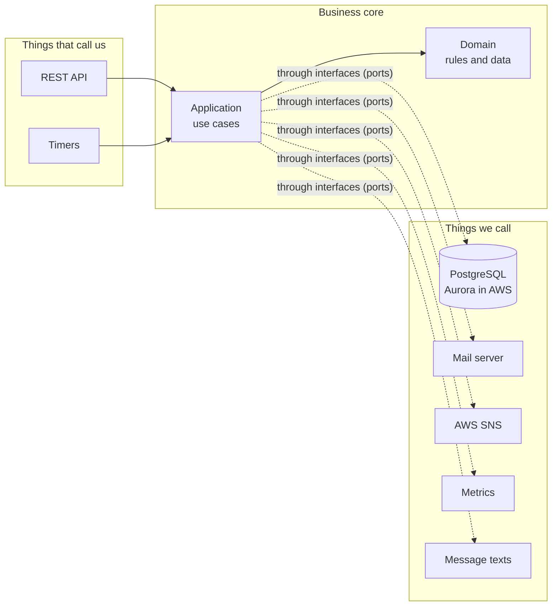
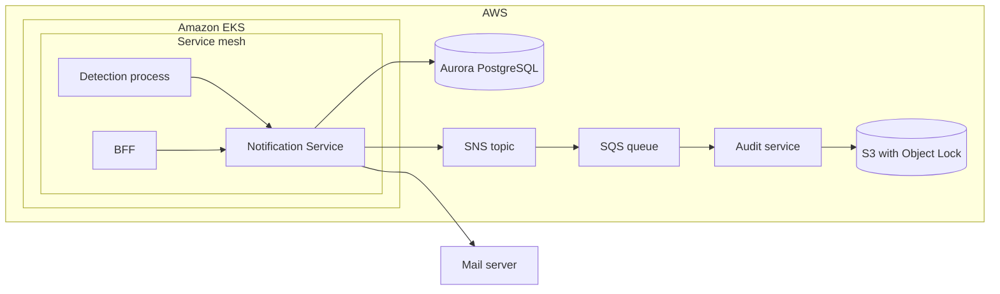
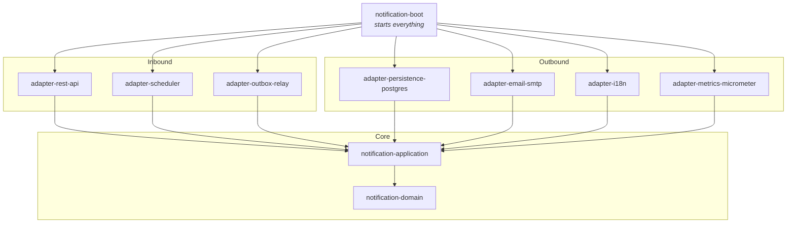
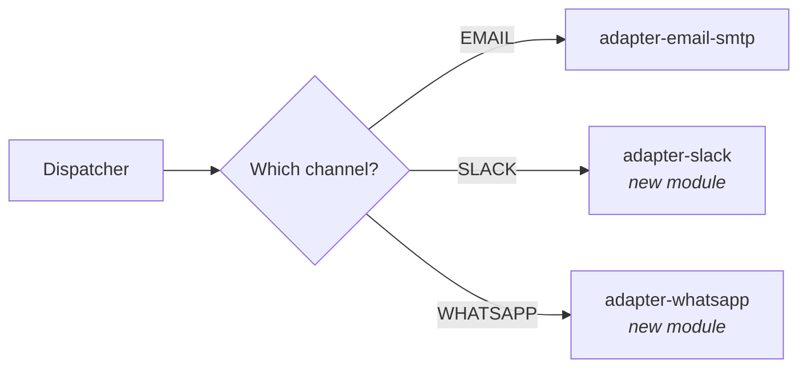

# 4. Architecture

## In short

- The business rules sit in the middle. Everything technical (web, database,
  e-mail, AWS, metrics) plugs in around them through small, well-named
  interfaces. This style is called **hexagonal** or **ports and adapters**.
- Each part is its own Maven module, so the compiler stops anyone from mixing
  them up (for example, business code cannot accidentally use the database
  directly).
- Adding a new channel means adding one module. Adding a new message type means
  adding one class, and the compiler shows every other place that needs updating.

## Technology

| What | Choice |
|---|---|
| Language | Java 25 |
| Framework | Spring Boot 4 |
| Database | PostgreSQL 18 (Amazon Aurora PostgreSQL in AWS, see [A10](03-assumptions.md#a10-everything-runs-in-aws)) |
| Database changes | Liquibase 5 |
| API contract | OpenAPI 3, code generated with openapi-generator |
| E-mail | Spring Mail (SMTP) |
| Audit transport | AWS SNS (AWS SDK v2), delivered to the audit service's SQS queue |
| Runtime | Pods in Amazon EKS, inside a service mesh |
| Metrics | Micrometer, exposed through Spring Boot Actuator |
| JSON | Jackson 3 (Spring Boot's shared `JsonMapper`) |
| Tests | JUnit Jupiter, Mockito, Testcontainers, GreenMail, LocalStack, JaCoCo |

## The big picture



The core only knows about **interfaces** ("save this", "send this e-mail",
"publish this audit event"). The modules on the right implement them. This means
we can swap the mail server for Slack, or SNS for Kafka, without touching the
business rules, and we can test the rules without any infrastructure.

## Where it runs



Everything except the mail server is in AWS (see
[Assumption A10](03-assumptions.md#a10-everything-runs-in-aws)). The SQS
queue, the audit service and the S3 archive belong to the audit team; this
service can only publish to its SNS topic. How audit events travel is described
in [Audit & compliance](08-audit-and-compliance.md#the-journey-of-an-audit-record);
the security view of this picture is in the
[threat assessment](09-security-threat-assessment.md#trust-boundaries).

## Modules



Arrows mean "depends on". Nothing depends on an adapter except `notification-boot`.

| Module | What it does |
|---|---|
| **notification-domain** | The business vocabulary: a notification, a site, a distribution list, a target, a channel. Checks the basic rules (e.g. confidence 0–100). No framework code. |
| **notification-application** | The use cases: receive a notification, send waiting notifications, update a distribution list, forward audit events. Defines the interfaces (ports) the adapters implement. |
| **adapter-rest-api** | The REST endpoints. Generated from the OpenAPI file, so the code and the contract can never disagree. Turns HTTP errors into a clear JSON error format. |
| **adapter-scheduler** | A timer that, every second, asks the application to send waiting notifications. |
| **adapter-outbox-relay** | A timer that forwards waiting audit events to AWS SNS, and deletes forwarded ones after 7 days. |
| **adapter-persistence-postgres** | Stores notifications, delivery attempts, distribution lists and audit events in PostgreSQL. Owns the Liquibase scripts. |
| **adapter-email-smtp** | Sends e-mails through an SMTP server. Decides which mail errors are worth retrying. |
| **adapter-i18n** | Builds the message text from a translation file (templates, document type labels, date format). |
| **adapter-metrics-micrometer** | Records the business and performance metrics. |
| **notification-boot** | Wires everything together and holds the end-to-end tests. |

## The interfaces (ports)

**Called from outside (inbound):**

| Port | Used by | Purpose |
|---|---|---|
| `IngestNotificationUseCase` | REST | Store a new notification (or recognise a repeat). |
| `UpsertDistributionListUseCase` | REST | Replace a customer's list of targets. |
| `DispatchInboxUseCase` | Scheduler | Send the waiting notifications. |
| `RelayAuditOutboxUseCase` | Outbox relay | Forward waiting audit events. |

**Called by the core (outbound):**

| Port | Implemented by | Purpose |
|---|---|---|
| `NotificationInboxPort` | Postgres | Save, claim and update notifications. |
| `DistributionListPort` | Postgres | Read and change distribution lists. |
| `DispatchLedgerPort` | Postgres | Record attempts; check "already delivered?". |
| `AuditOutboxWriterPort` / `AuditOutboxReaderPort` | Postgres | Write audit events; read them for forwarding. |
| `AuditEventBrokerPort` | SNS (or log, locally) | Publish audit events. |
| `NotificationSenderPort` | SMTP (one per channel) | Deliver one message to one target. |
| `MessageRenderer` | i18n | Turn a notification into text. |
| `NotificationMetricsPort` | Micrometer | Count and time things. |

## Adding things later

FR.1.7 asks that new channels and new notification types can be added. The two
are handled differently on purpose.

### A new channel (e.g. Slack, WhatsApp)

Channels are an **open list**: any team could add one, and each brings its own
library and settings. So a channel is a **plug-in**.



Steps:

1. Add the value to `DistributionChannel` (`SLACK` already exists).
2. Create a new module with a class that implements `NotificationSenderPort`.
3. Add it to `notification-boot`.

Nothing in the core changes. Until step 2 is done, deliveries to that channel
fail with "No sender configured for channel: SLACK", which is how Slack behaves
today.

### A new kind of notification (e.g. certificate expiry)

Message types are a **closed list** that this service owns. Each type has its own
fields and its own text. Here we want the compiler to help: every message type is
one record in a *sealed* family, and every place that handles them uses a
`switch` that must cover **all** of them.

```java
return switch (payload) {
    case RegulatoryEventPayload e   -> render("regulatory-event", …);
    case CertificateExpiryPayload c -> render("certificate-expiry", …);
};  // add a new type and this stops compiling until you handle it
```

Steps:

1. Add the record (e.g. `CertificateExpiryPayload`) to the sealed
   `NotificationPayload` family and a value to `MessageType`.
2. Add its text to the translation file and its `case` to the renderer. The
   compiler points at the missing case.
3. Add its schema to the OpenAPI file and its `case` to the REST mapper.

No database change is needed: the notification's content is stored as JSON.
`CERTIFICATE_EXPIRY` was added this way and works end to end.

## Rules every module follows

- Business code never imports Spring Web, JPA, mail or AWS classes.
- One concept has one name everywhere (code, tables, docs). For example, the
  table `notification_inbox`, the entity `NotificationInboxEntity` and the port
  `NotificationInboxPort`.
- Every change to data and its audit event are saved in **the same database
  transaction**: either both happen or neither does.

---

← [3. Assumptions](03-assumptions.md) · [Docs index](README.md) · [5. How it works](05-how-it-works.md) →
