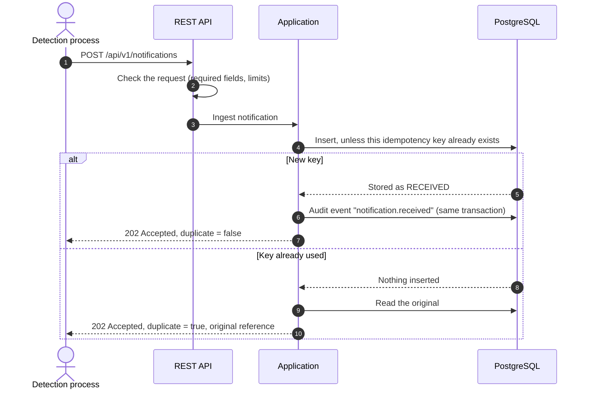
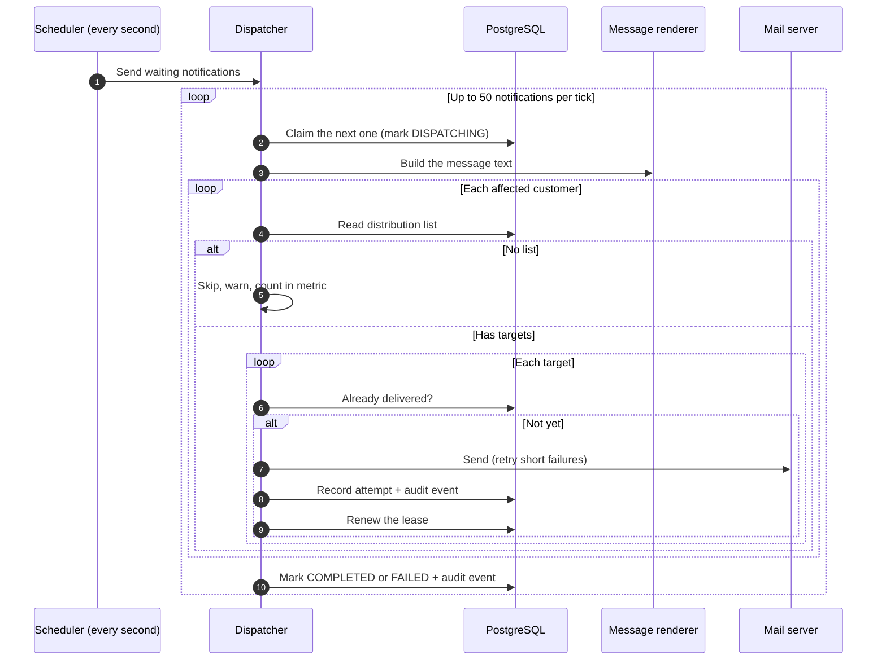
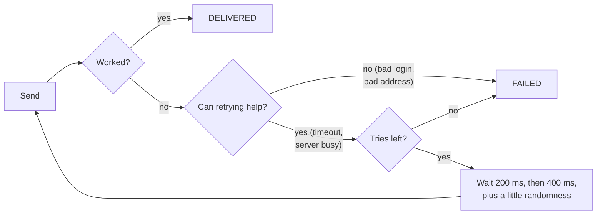
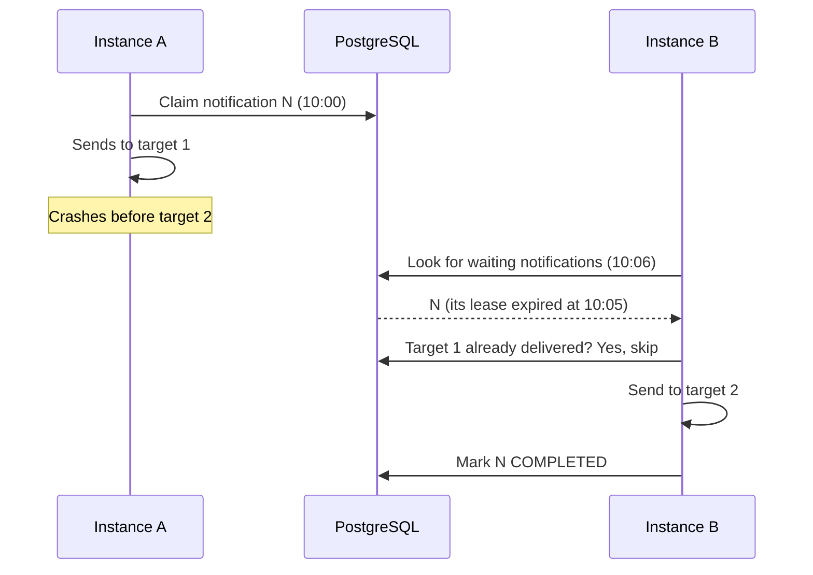
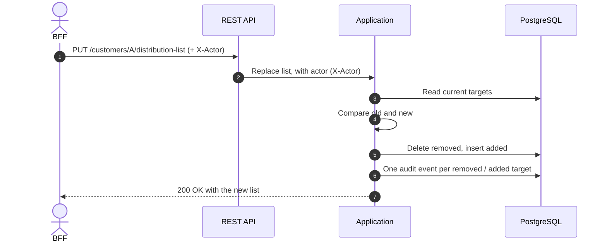
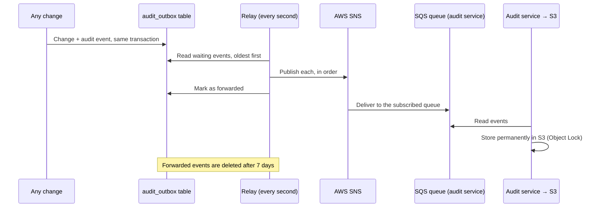
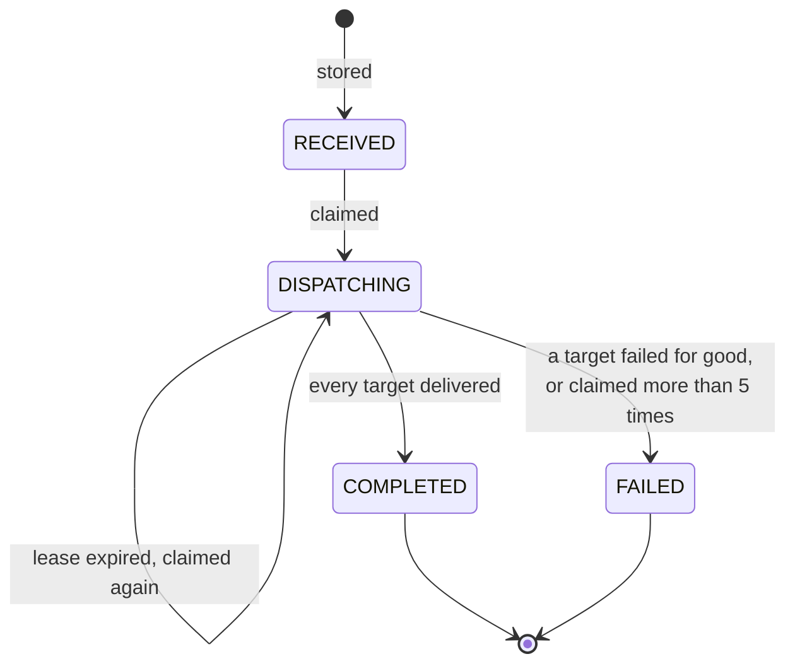

# 5. How it works

## In short

1. **Receive**: the API stores the notification and answers straight away.
2. **Send**: every second, a background job picks up waiting notifications,
   builds the message and e-mails every target, retrying short failures.
3. **Record**: every attempt and every change is saved and forwarded to the
   audit archive.

Receiving and sending are separate on purpose. The caller never waits for e-mails,
and a slow or broken mail server never causes the API to fail.

## 1. Receiving a notification

- The [idempotency key](01-overview.md#key-words) makes repeats harmless. If
  the caller times out and sends again, the second request returns the first
  result ([details](06-api.md#sending-the-same-request-twice)).
- The check and the insert are **one database statement**
  (`INSERT … ON CONFLICT DO NOTHING`), so two identical requests arriving at the
  same moment still create only one notification.
- `202 Accepted` means "safely stored", not "delivered".

## 2. Sending notifications

Step by step:

1. **Claim.** The job claims one waiting notification at a time (up to 50 per
   run) and marks it `DISPATCHING` with the current time. It skips rows another copy of the
   service is already handling, so no notification is sent twice (see
   [crash recovery](#3-recovering-from-a-crash)).
2. **Build the message.** The text is built once per notification from the
   template in the translation file, e.g.
   `Site {site}, located at {address} received a {authority} {document type} on {date}. [{confidence}%]`.
   The document type code becomes a readable label ("warning letter"), and the
   date is written as "12 June 2026".
3. **Find the targets.** For each affected customer, read their distribution
   list. A customer **without a list** is skipped, with a warning and a metric.
   We never make up an address.
4. **Skip what is done.** If the [dispatch ledger](01-overview.md#key-words) says this target already
   received this notification (for example before a crash), skip it.
5. **Send, retrying short failures.** See [retries](#retries) below.
6. **Record.** Every attempt, successful or not, is saved in the dispatch ledger
   together with an audit event, in one transaction.
7. **Finish.** If every target was delivered (or skipped because it was already
   delivered), the notification becomes `COMPLETED`. If any target failed for
   good, it becomes `FAILED` with the reason, so someone can look at it.

One failing target never stops the others.

### Retries

- At most **3 tries** per target, with a pause that doubles each time.
- Some errors will never fix themselves (wrong mail password, malformed
  address). Those are **not** retried.
- The randomness in the pause stops many retries from hitting the server at the
  same moment.
- This is a simple loop of about 20 lines, not a library, because one retry rule
  is all we need.

## 3. Recovering from a crash

What if the service stops while sending? The notification is stuck in
`DISPATCHING`. To handle that, a claim is a [lease](01-overview.md#key-words):
it only lasts 5 minutes.

- The lease (5 minutes) is renewed after every send, so it only has to be
  longer than the worst case for sending to **one** target. Every mail call has
  a connect and read timeout, which keeps that worst case bounded.
- Each claim is counted. If a notification has been claimed **more than 5
  times**, something about it keeps crashing the service, so it is marked
  `FAILED` ("max claim attempts exceeded") instead of looping forever.
- The claim uses `FOR UPDATE SKIP LOCKED`, a PostgreSQL feature that lets several
  copies of the service work side by side: each skips the rows another copy is
  holding.

## 4. Changing a distribution list

Only the differences are written. If you send the same list twice, nothing
changes and no audit events are created.

## 5. Forwarding audit events

The full journey (SNS → SQS → audit service → S3), and why it can be trusted, is
described in
[Audit & compliance](08-audit-and-compliance.md#the-journey-of-an-audit-record).

## The life of a notification

`COMPLETED` and `FAILED` are final: a failed notification is not retried
automatically. The ledger shows exactly which targets failed and why. To send it
again, the caller submits it with a **new** idempotency key; this is a new
notification and goes to every target again.

---

← [4. Architecture](04-architecture.md) · [Docs index](README.md) · [6. API](06-api.md) →
