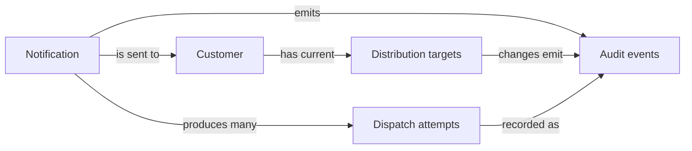
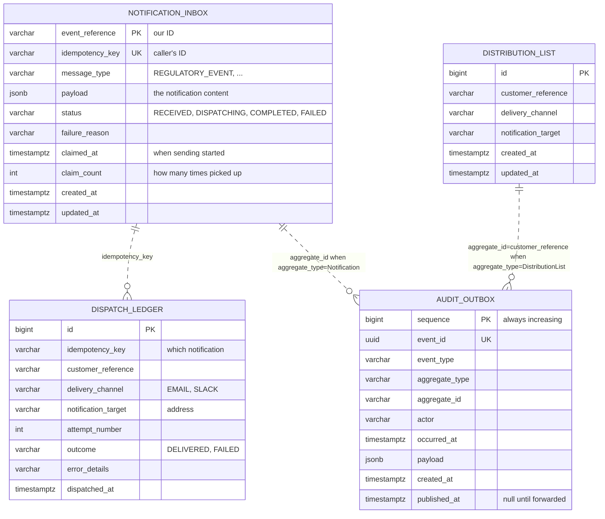

# 7. Data model

## In short

Four tables in PostgreSQL:

| Table | Holds | Kept for |
|---|---|---|
| `notification_inbox` | Each notification received and its status | Always |
| `dispatch_ledger` | Each delivery attempt | Always |
| `distribution_list` | Each customer's current targets | While they are on the list |
| `audit_outbox` | Audit events waiting to be forwarded | 7 days after forwarding |

The schema is created and changed only by **Liquibase** scripts.

## 1. Conceptual model

Business concepts and how they relate (no SQL details):

- A **notification** is the unit of work accepted by the API.
- A customer's **distribution targets** are the current destinations (e-mail, Slack, ...).
- Sending a notification produces one or more **dispatch attempts**.
- Important state changes produce **audit events** and are relayed asynchronously.

## 2. Logical model

Entity-level rules independent of PostgreSQL data types:

| Entity | Identifier | Core relationships | Invariants |
|---|---|---|---|
| Notification | `event_reference` | 1 notification -> 0..n dispatch attempts; 1 notification -> 0..n audit events | `idempotency_key` is unique; terminal states are `COMPLETED`/`FAILED` |
| Dispatch attempt | notification + customer + channel + target + attempt number | n attempts -> 1 notification (by `idempotency_key`) | Append-only; outcome is `DELIVERED` or `FAILED` |
| Distribution target | customer + channel + target | n targets -> 1 customer | No duplicate target per customer and channel |
| Audit event | `event_id` (`sequence` for ordering) | n events -> 1 aggregate (`Notification`, `DispatchAttempt`, `DistributionList`) | Append-only; relay marks forwarded rows with `published_at` |

## 3. Physical model (PostgreSQL ERD)

The dotted lines are links by value, **not** foreign keys.

- The ledger and outbox are append-heavy and must survive independently.
- `audit_outbox.aggregate_id` is polymorphic: it points to different business
  identifiers depending on `aggregate_type`.
- For `DispatchAttempt` events, `aggregate_id` stores the notification
  `idempotency_key`, not `dispatch_ledger.id`.
- Surrogate keys (`dispatch_ledger.id`, `distribution_list.id`) exist only for
  the database; the business keys are listed in the [logical model](#2-logical-model).

## 4. The tables

### notification_inbox

One row per notification.

- **`idempotency_key` is unique**, which is how repeats are detected.
- **`payload` is JSON** (`jsonb`). Each message type has different fields, and
  the service never searches inside them. Storing the content as JSON means a new
  message type needs **no database change**. The content is still strictly
  checked on the way in (by the API contract and the domain classes).
- `message_type` is a normal column so operators can filter by it in SQL.
- `claimed_at` and `claim_count` support crash recovery
  ([how it works](05-how-it-works.md#3-recovering-from-a-crash)).
- Index on `(status, created_at)` so finding waiting notifications stays fast.

### dispatch_ledger

One row per **attempt**, never updated or deleted. It answers questions like
"did CUST-1 get the warning about site X, and when?"

- `outcome` is `DELIVERED` or `FAILED`; `error_details` says why, cut to 1,000
  characters.
- A small index covering **only `DELIVERED` rows** makes the check
  "was this target already reached for this notification?" fast. That check is
  what prevents duplicate e-mails after a crash.

### distribution_list

One row per target currently on a customer's list.

- No two rows can have the same customer, channel and address.
- There are no "active" flags or version numbers: a removed target is simply
  deleted. The history of who added or removed it is in the audit trail.

### audit_outbox

A **waiting room** for audit events, not their permanent home.

- Written in the **same transaction** as the change it describes.
- `sequence` always increases, so the audit service can detect gaps.
- Forwarded rows get `published_at`. An hourly purge job deletes them 7 days
  later (`notification.audit.outbox.retention`, default `P7D`).
- Two small indexes: one for "not yet forwarded" (what the relay reads) and one
  for "forwarded" (what the clean-up reads).

## 5. Which process touches which table

Whenever a step writes an audit event, it does so in the same transaction as the
change it describes, so neither can exist without the other.

| Process step | Reads | Writes (audit event in `audit_outbox`) |
|---|---|---|
| Receive a notification | `notification_inbox` (by `idempotency_key`) | Inserts `notification_inbox` as `RECEIVED` (`notification.received`); a repeated key writes nothing |
| Claim for sending | `notification_inbox` | Sets `DISPATCHING`, `claimed_at`, `claim_count + 1` (no audit event); rows claimed too often become `FAILED` (`notification.status-changed`) |
| Send to one target | `distribution_list`, `dispatch_ledger` (already delivered?) | Inserts `dispatch_ledger` (`notification.delivery.attempt-recorded`); then renews `claimed_at` in a separate transaction |
| Finish a notification | — | Sets `notification_inbox` to `COMPLETED` or `FAILED` (`notification.status-changed`) |
| Replace a distribution list | `distribution_list` | Deletes removed / inserts added targets (`notification.distribution-list.target-removed` / `-added`) |
| Forward audit events | `audit_outbox` (unpublished, by `sequence`) | Sets `published_at` |
| Purge forwarded events | — | Deletes `audit_outbox` rows forwarded more than 7 days ago |

State transitions, retries, and crash recovery are described in
[How it works](05-how-it-works.md#the-life-of-a-notification); this page only
covers the storage that supports them.

## 6. Database changes (Liquibase)

Scripts live in
`../adapter-persistence-postgres/src/main/resources/db/changelog/changes`:

| Script | What it does |
|---|---|
| `001-create-core-tables.sql` | Creates the four tables and their indexes |
| `002-seed-initial-data.sql` | Adds one demo distribution list (`demo-customer`) |

Rules:

- A script that has run is **never edited**. Every change is a new script.
- Column sizes follow the API contract, so a request the API accepts can always
  be stored.
- New message types need no script, because their content is JSON.
- The demo data is for local use and tests. ⚠️ Today it runs in every
  environment; it must be limited to a `local` Liquibase context
  ([gap G4](09-security-threat-assessment.md#open-gaps)).

---

← [6. API](06-api.md) · [Docs index](README.md) · [8. Audit & compliance](08-audit-and-compliance.md) →
