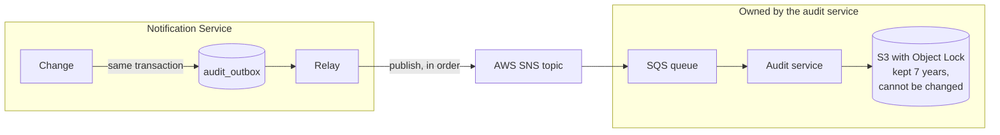

# 8. Audit and compliance

## In short

- **Every change and every delivery attempt** is recorded, with who did it and
  when (FR.1.6).
- Records are written **in the same transaction** as the change, so a change
  cannot happen without its record.
- They are forwarded through **SNS and SQS** to a **central archive that nobody
  can edit or delete** (S3 with Object Lock), owned by a separate audit service.
- Day-to-day questions ("was this customer told?") are answered from the
  **dispatch ledger** in our own database.

## What is recorded

| What happened | Audit event | Also in |
|---|---|---|
| A notification was received | `notification.received` | `notification_inbox` |
| A notification changed status | `notification.status-changed` | `notification_inbox` |
| A delivery was attempted (success or failure) | `notification.delivery.attempt-recorded` | `dispatch_ledger` |
| A target was added to a distribution list | `notification.distribution-list.target-added` | `distribution_list` |
| A target was removed from a distribution list | `notification.distribution-list.target-removed` | — |

Every audit event contains:

| Field | Example |
|---|---|
| Event ID (unique) | `5b0c…` |
| Sequence number (always increasing) | `1042` |
| Type | `notification.delivery.attempt-recorded` |
| What it is about | `DispatchAttempt` / `7f3c2b10-…` |
| Who | `jane.doe@qualifyze.com` (from `X-Actor`) for list changes, `notification-api` or `system` otherwise |
| When | `2026-06-12T09:14:03Z` |
| Details | recipient, channel, attempt number, result, error |

This covers the minimum the brief asks for:

| Brief asks to track | Where |
|---|---|
| Recipient | `notification_target` in the ledger and the event |
| Timestamp | `dispatched_at` / `occurred_at` |
| Event reference | idempotency key and event reference |
| Delivery status | `outcome` (`DELIVERED` / `FAILED`) and `error_details` |
| Distribution list changes | `target-added` / `target-removed` with who and when |

## The journey of an audit record

1. **Write.** The change and its audit event are saved together. If one fails,
   both are undone.
2. **Forward.** Every second, the relay sends waiting events to SNS in order and
   marks them as forwarded.
3. **Queue.** SNS delivers each event to the audit service's SQS queue. The
   queue keeps it until the audit service confirms it is stored, so the audit
   service can be down without losing anything.
4. **Store.** The central audit service reads the queue and writes the events
   to S3 with Object Lock in *compliance mode*: for 7 years, not even an
   administrator can change or delete them.
5. **Clean up.** We delete our copy 7 days after forwarding. The archive is the
   permanent record.

## Why it can be trusted

| Risk | How it is handled |
|---|---|
| A change is saved but its record is lost | Both are in one transaction. |
| SNS is down | Events wait in the outbox and are sent later. Nothing is lost. A metric shows the backlog. |
| The audit service is down | Events wait in its SQS queue (kept up to 14 days) and are stored once it is back. Events it cannot process go to a dead-letter queue instead of being dropped. |
| An event goes missing on the way | Sequence numbers always increase, so the audit service can spot a gap. |
| Events arrive out of order | The SNS topic and the SQS queue are FIFO, so the order is kept end to end. |
| The same event arrives twice | Each has a unique event ID, so duplicates are ignored. |
| Someone edits the history | The archive is write-once. This service can only *publish* to SNS; it has no access to the queue or the archive. |
| A record is edited in our database before it is forwarded | Possible only for a database administrator, in a window of about a second. A *hash chain* (each event includes a fingerprint of the previous one) would close this gap; it is on the [roadmap](14-limitations-and-roadmap.md). |

## Two records of a delivery: why?

| | Dispatch ledger | Audit event |
|---|---|---|
| **Purpose** | Run the service | Prove what happened |
| **Read by** | The dispatcher ("already delivered?"), operators | Auditors, on request |
| **Lives in** | Our Aurora PostgreSQL database, permanently | The central archive, for 7 years |
| **Can be queried with SQL** | Yes | Through the archive's tools |

They hold the same facts but serve different people. Keeping them separate means
our database stays simple, and compliance does not depend on it.

## ISO 27001 and SOC 2

| Control (simplified) | How this service helps |
|---|---|
| Logging of user and system activity (ISO 27001 A.8.15) | Every change and send is an audit event with who and when. |
| Protection of log information | Write-once archive, no access from this service, gap detection. |
| Change management | Distribution-list changes record the person and the service; schema changes go only through versioned Liquibase scripts. |
| Monitoring (SOC 2 CC7.2) | Metrics on failures, skipped customers and audit backlog, with alerts. |
| Confidentiality (SOC 2 C1) | No personal data in metrics; no internal details in error responses. |

## Answering an auditor

| Question | Where to look |
|---|---|
| "Was customer X told about the warning letter for site Y?" | `dispatch_ledger`, filtered by customer and idempotency key |
| "Who added this address to customer X's list, and when?" | `target-added` events in the archive |
| "Show everything that happened to notification N" | All archive events for that event reference, ordered by sequence |
| "Is the history complete?" | Check the sequence numbers have no gaps |
