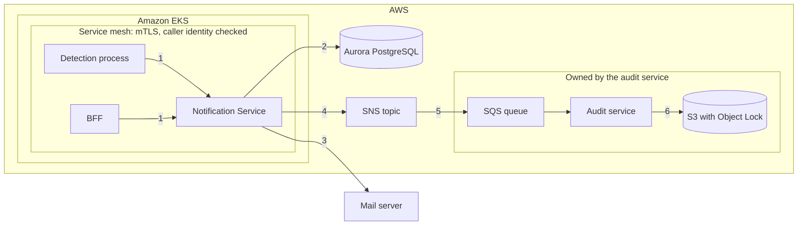

# 9. Security threat assessment

## In short

- The service is **internal** and runs entirely in **AWS** behind a
  [service mesh](01-overview.md#key-words) (see
  [Assumption A10](03-assumptions.md#a10-everything-runs-in-aws)): pods in
  Amazon EKS behind a service mesh, Aurora PostgreSQL, and SNS → SQS → audit
  service → S3 for the audit trail. Only the **mail server** is outside AWS.
- Being "inside AWS" protects nothing on its own. Every boundary below is held
  by **IAM**, the **service mesh** and **network rules**, so a mistake in any of
  them matters as much as an open port.
- The main risks are: sending a warning to the **wrong person**, **losing or
  altering** the audit trail, and **leaking** customer contacts.
- Each risk below has a likelihood, an impact, how we reduce it, and what risk
  remains. [Mitigation check](#mitigation-check) shows which controls are in
  the code today, which must be set up in AWS, and which are still missing.
- **No threat is rated high.** Four code gaps remain, listed once in
  [Open gaps](#open-gaps).

**On this page:** [What we protect](#what-we-protect) ·
[Trust boundaries](#trust-boundaries) · [Threats](#threats) ·
[Mitigation check](#mitigation-check) · [Open gaps](#open-gaps) ·
[Summary](#summary)

Status markers: ✅ in code · ☁️ set up in AWS / mesh · ⚠️ gap
([legend](README.md#status-markers)).

## What we protect

| Asset | Why it matters |
|---|---|
| Distribution lists (customer e-mail addresses) | Personal data; a wrong address sends confidential information to a stranger. |
| Notification content | Unpublished links between sites and customers are commercially sensitive. |
| Audit trail | Needed to prove compliance (ISO 27001, SOC 2). |
| Aurora backups and snapshots | A full copy of the lists, ledger and audit outbox. |
| Credentials and AWS identity (database, mail, the pod's IAM role) | Give access to all of the above. |

## Trust boundaries

1. **Callers → service** (inside the mesh): is the caller who they claim to
   be, may it call this endpoint, and is the input safe?
2. **Service → Aurora**: who else can reach, read or change the data? Is the
   connection encrypted?
3. **Service → mail server**: the only boundary that **leaves AWS**. Can the
   mail be read, changed or misdirected on the way?
4. **Service → SNS**: who may publish audit events? Can they be lost?
5. **SNS → SQS → audit service**: can events be lost, reordered or faked?
6. **Audit service → S3**: can history be changed?

Across all of them: can another pod in the cluster **borrow our AWS identity**
or our database password?

## Threats

We use **STRIDE**, a standard checklist: **S**poofing, **T**ampering,
**R**epudiation, **I**nformation disclosure, **D**enial of service,
**E**levation of privilege.

| # | Threat | Type | Likelihood | Impact | Risk |
|---|---|---|---|---|---|
| T1 | Someone pretends to be an internal service, or calls an endpoint it should not | S, E | Low | High | Medium |
| T2 | Someone pretends to be another person in `X-Actor` | S, R | Medium | Medium | Medium |
| T3 | Harmful or huge input | T, D | Medium | Medium | Medium |
| T4 | Warning sent to the wrong person | I | Low | High | Medium |
| T5 | Audit trail lost or altered | T, R | Low | High | Medium |
| T6 | Customer data leaks in errors, logs, metrics or backups | I | Medium | Medium | Medium |
| T7 | Mail server outage causes overload or stuck work | D | Medium | Low | Low |
| T8 | Stolen credentials or AWS identity | E | Low | High | Medium |
| T9 | The same request is replayed | T | Medium | Low | Low |
| T10 | E-mail read or changed on the way | I, T | Low | High | Medium |
| T11 | Fake audit events injected after this service | S, T | Low | High | Medium |

### T1. Someone pretends to be an internal service

- **Prevented by:**
  - **Strict** mutual TLS in the service mesh: a pod without a mesh identity
    cannot connect, and Kubernetes NetworkPolicies block traffic that tries to
    go around the mesh.
  - An allow list **per path**: only the detection process may call
    `POST /api/v1/notifications`, only the BFF may call
    `PUT /api/v1/customers/{customerReference}/distribution-list`, and only
    monitoring may read `/actuator`.
  - The mesh tells us the caller's identity in the `X-Forwarded-Client-Cert`
    header and **overwrites** any value the caller tries to set
    (`SANITIZE_SET`), so it cannot be faked.
- **Remaining risk:** a compromised allowed pod (for example the BFF) can do
  whatever that pod is allowed to do, for every customer. User login and
  per-customer permissions live in the BFF (see
  [Assumptions A5](03-assumptions.md#a5-only-internal-services-call-the-api)).
  If the per-path rule is not set up, every allowed service can change every
  list (see [Limitations](14-limitations-and-roadmap.md)).

### T2. Someone fakes the person in `X-Actor`

- **Prevented by:** only the BFF can reach the distribution-list endpoint
  (per-path mesh rule, T1), and the BFF sets `X-Actor` from the user it has
  logged in.
- **Gap ⚠️ [G2](#open-gaps):** `X-Actor` is optional. A change without it is
  recorded as `notification-service`, so it cannot be traced to a person.
- **Remaining risk:** the person's name is only as trustworthy as the BFF. It
  is attribution, not proof of identity. Storing the mesh identity of the
  calling service next to it is on the roadmap.

### T3. Harmful or huge input

- **Prevented by:** every field has a type, a length limit and a range, checked
  before anything is stored (255 characters for names and keys, 512 for the
  address, 64 for customer references, 320 for targets, 128 for `X-Actor`). A
  distribution list has at most 50 targets. E-mail addresses are checked for
  valid syntax. The database is only called with parameters, never with
  string-built SQL. Messages are sent as plain text, never HTML.
- **Gap ⚠️ [G1](#open-gaps):** the API contract allows up to **1,000**
  customers per notification, not the 50 we assume
  ([S7](03-assumptions.md#smaller-assumptions)). With 50 targets each, one
  request could send up to 50,000 e-mails.
- **Remaining risk:** low once the limit is fixed.

### T4. Warning sent to the wrong person

- **Prevented by:** recipients come **only** from the stored distribution list. A
  customer without a list is skipped; we never guess an address. Every list
  change records who made it.
- **Remaining risk:** a wrong address typed by a person. The audit trail shows
  who added it.

### T5. Audit trail lost or altered

- **Prevented by:**
  - The audit event is written in the same transaction as the change, and
    sequence numbers that always increase reveal gaps.
  - If SNS is down, events wait in our outbox. If the audit service is down,
    they wait in its SQS queue (kept up to 14 days, with a dead-letter queue
    for events it cannot process). Our outbox keeps forwarded events for 7
    more days as a safety copy.
  - The SNS topic and the SQS queue are FIFO, so the order is kept end to end.
  - The archive is S3 with Object Lock in *compliance mode*. This service's IAM
    role can only publish to its topic; it cannot read or change the queue or
    the archive. See [Audit & compliance](08-audit-and-compliance.md).
- **Remaining risk:**
  - Anyone with write access to our Aurora database (an administrator, or the
    service's own database user) could edit an event in the second before it
    is forwarded. A hash chain is on the roadmap.
  - An administrator of the audit team's AWS account could purge the queue
    before events are stored. Sequence gaps would show it. Keeping the archive
    in a separate AWS account limits who can do this.

### T6. Data leaks in errors, logs, metrics or backups

- **Prevented by:**
  - Error responses for `500` and `503` contain a generic message only; details
    go to our logs.
  - Metrics contain no personal data, only channel, result and error type.
  - Error details stored in the ledger are cut to 1,000 characters.
  - Aurora is encrypted with KMS, is not public, and its security group only
    accepts this service's pods. The connection uses TLS with certificate
    checking (`sslmode=verify-full`). Snapshots are encrypted and only a few
    people may restore or share them.
  - SNS and SQS are encrypted with KMS and reached through VPC endpoints, so
    audit events (which contain addresses) never travel over the internet.
- **Remaining risk:** addresses are in the ledger and audit events because
  FR.1.6 requires it. Access to the database, its snapshots, the queue and the
  archive must be limited to the people who need it. A `422` response repeats
  the business-rule message; today these messages contain no personal data.

### T7. Mail server outage

- **Prevented by:** at most 3 tries per target with growing pauses; errors that
  cannot fix themselves are not retried; every mail call has a time limit
  (10 s); a notification that keeps crashing the service is stopped after 5
  tries. The API keeps working because sending happens in the background.
- **Remaining risk:** low.

### T8. Stolen credentials or AWS identity

- **Prevented by:**
  - No secrets in code. In AWS they come from AWS Secrets Manager into
    environment variables.
  - AWS access uses an **IAM role tied to the pod's Kubernetes service account**
    (IRSA or EKS Pod Identity), with no stored keys. The role may only
    `sns:Publish` to the audit topic.
  - Pods cannot borrow the EKS node's IAM role: IMDSv2 is required with a hop
    limit of 1.
  - The service connects to Aurora with its own database user, not the master
    user.
- **Remaining risk:** the local defaults are dummy values (`postgres`/`postgres`
  for the database, `test`/`test` and a `localhost` endpoint for AWS) so the
  service works with Docker and LocalStack. They must be overridden in every
  real environment. If the AWS ones are left in, publishing fails and the audit
  backlog alert fires, so the mistake is visible.

### T9. Replay of the same request

- **Prevented by:** the idempotency key, enforced by a unique index in the
  database. A repeated request returns the original result and sends nothing.
- **Remaining risk:** none for the same key. A replay with a new key is a new
  notification; only the detection process may send one (T1).

### T10. E-mail read or changed on the way

The mail server is the only dependency outside AWS, so this is the only hop
not protected by AWS networking.

- **Prevented by:** SMTP login and STARTTLS (turned on by configuration in
  production).
- **Gap ⚠️ [G3](#open-gaps):** STARTTLS is *opportunistic*: if the server or a
  man in the middle does not offer it, the mail is sent unencrypted.
- **Remaining risk:** after the mail server, delivery to the customer's mail
  provider is outside our control.

### T11. Fake audit events injected after this service

- **Prevented by:** the SNS topic policy only accepts `Publish` from this
  service's IAM role; the SQS queue policy only accepts messages from that
  topic (`aws:SourceArn`), as in the local setup. Each event names its source
  service and has a sequence number and a unique ID, so the audit service can
  spot events that do not fit.
- **Remaining risk:** anyone who controls this service's IAM role could publish
  fake events (see T8).

## Mitigation check

We checked every control against the code and the configuration in this
repository. Controls marked ☁️ live outside the code and must be confirmed in
each environment.

| Control | Threats | Where | Status |
|---|---|---|---|
| Length limits on every field; 50 targets per list | T3 | OpenAPI contract, domain | ✅ In code |
| At most 50 customers per notification | T3 | OpenAPI contract | ⚠️ [G1](#open-gaps): contract says 1,000 |
| E-mail syntax check | T3, T4 | `DistributionListTarget` | ✅ In code |
| Parameterised SQL only | T3 | Repositories | ✅ In code |
| Plain-text e-mail | T3 | SMTP adapter (`SimpleMailMessage`) | ✅ In code |
| Recipients only from stored lists; skip if none | T4 | Dispatch use case | ✅ In code |
| Generic `500`/`503` messages | T6 | `ApiExceptionHandler` | ✅ In code |
| No personal data in metrics | T6 | `NotificationMetrics` | ✅ In code |
| Error details cut to 1,000 characters | T6 | `TargetDispatcher` | ✅ In code |
| 3 tries, backoff, no retry on permanent errors, 10 s mail timeout, 5 claims max | T7 | Dispatcher, SMTP config | ✅ In code |
| Unique idempotency key | T9 | Database unique index | ✅ In code |
| Audit event in the same transaction; increasing sequence | T5 | Persistence adapters | ✅ In code |
| FIFO message group and deduplication ID | T5 | SNS adapter (when the topic ends in `.fifo`) | ✅ In code · ☁️ topic must be FIFO |
| Default AWS credentials when no keys are set | T8 | `AwsAuditBrokerConfiguration` | ✅ In code |
| `X-Actor` required for list changes | T2 | API contract | ⚠️ [G2](#open-gaps): optional, falls back to `notification-service` |
| STARTTLS required | T10 | SMTP config | ⚠️ [G3](#open-gaps): only opportunistic |
| Demo seed data only in local | — | Liquibase | ⚠️ [G4](#open-gaps): runs everywhere |
| Strict mTLS, per-path allow list, `SANITIZE_SET`, NetworkPolicies | T1, T2 | Mesh, EKS | ☁️ AWS / mesh |
| IRSA role limited to `sns:Publish`; IMDSv2 hop limit 1 | T8, T11 | IAM, EKS | ☁️ AWS / mesh |
| Secrets from Secrets Manager | T8 | Deployment | ☁️ AWS / mesh |
| Aurora: KMS, private, security group, TLS `verify-full`, own user, snapshot access | T6, T8 | Aurora, JDBC URL | ☁️ AWS / mesh |
| SNS/SQS: FIFO, KMS, VPC endpoints, topic and queue policies, DLQ, 14-day retention | T5, T6, T11 | SNS, SQS | ☁️ AWS / mesh (audit team for SQS) |
| S3 Object Lock in compliance mode, separate account | T5 | S3 | ☁️ AWS / mesh (audit team) |

## Summary

| Risk level | Threats |
|---|---|
| High | none |
| Medium | T1, T2, T3, T4, T5, T6, T8, T10, T11 (all reduced by the controls above) |
| Low | T7, T9 |

---

← [8. Audit & compliance](08-audit-and-compliance.md) · [Docs index](README.md) · [10. Metrics](10-metrics.md) →
