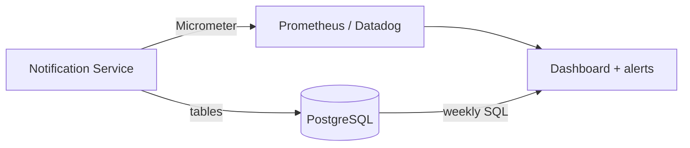

# 10. Metrics

## In short

- **Adoption metrics** answer: *is the feature used, and does it reach the
  people it should?*
- **Performance metrics** answer: *are messages delivered, quickly and reliably?*
- Every metric below is ✅ published by the service today. The alerts and
  dashboard are 📋 proposed.
- Live numbers come from **Micrometer** (exposed through Spring Boot Actuator and
  ready for Prometheus, Datadog or CloudWatch). Weekly business numbers come from
  simple **SQL** on our own tables.



## Metrics the service publishes

| Metric | Type | Labels | Meaning |
|---|---|---|---|
| `notification.events.processed` | counter | — | Notifications finished (completed or failed) |
| `notification.customers.notified` | counter | — | Customers that received at least one message |
| `notification.customers.skipped` | counter | `reason` | Customers skipped, e.g. `no_distribution_list` |
| `notification.dispatch.attempts` | counter | `channel`, `result`, `retry`, `error_type` | Every delivery attempt |
| `notification.dispatch.latency` | timer | `channel`, `result`, `retry` | How long each attempt took |
| `notification.audit.outbox.published` | counter | — | Audit events forwarded to SNS |
| `notification.audit.outbox.depth` | gauge | — | Audit events waiting to be forwarded |
| `notification.audit.outbox.oldest_age_seconds` | gauge | — | Age of the oldest waiting audit event |

Label values: `result` = `success` / `failure`; `retry` = `true` / `false`;
`error_type` = `none` / `transient` / `permanent`; `channel` = `email` / `slack`.

None of them contain personal data (no addresses, no customer IDs).

## Adoption metrics

| Question | Metric | How to read it |
|---|---|---|
| How many events do we send out? | Events per week | `increase(notification_events_processed_total[7d])`. Expected 1–5. |
| How many customers do we reach? | Customers notified per week | `increase(notification_customers_notified_total[7d])`. Expected 10–125 (1–5 events × 10–25 customers). |
| Are customers set up? | **Reach rate** = notified ÷ (notified + skipped) | Target ≥ 95 %. Low means customers have no distribution list. |
| How many customers have a list? | Customers with a list | SQL: `SELECT count(DISTINCT customer_reference) FROM distribution_list;` |
| Do customers maintain their lists? | List changes per month | Count of `target-added` / `target-removed` audit events |
| Which channels are used? | Attempts by channel | `sum by (channel) (increase(notification_dispatch_attempts_total[30d]))` |
| Is the new message type used? | Notifications per type | SQL: `SELECT message_type, count(*) FROM notification_inbox GROUP BY 1;` |

We do **not** track whether e-mails are opened or clicked. That needs tracking
pixels, which raise privacy questions; it can be added later through the mail
provider if the business needs it.

## Performance metrics

| Question | Metric | Target |
|---|---|---|
| Are messages delivered? | **Delivery success rate** = targets delivered ÷ targets attempted | ≥ 99 % |
| How often do we need retries? | **Retry rate** = attempts with `retry="true"` ÷ all attempts | < 5 % |
| How fast is one send? | **Send time** (p95 of `notification_dispatch_latency`) | < 2 s |
| How long until customers know? | **Time to notify** = from received to completed | p95 < 1 min |
| Is anything stuck? | Notifications in `DISPATCHING` for more than 10 min | 0 |
| Is the audit trail keeping up? | `notification_audit_outbox_oldest_age_seconds` | < 60 s |

Example queries (Prometheus):

```promql
# Delivery success rate, last 7 days
# (each target has exactly one first attempt, retry="false")
sum(increase(notification_dispatch_attempts_total{result="success"}[7d]))
/
sum(increase(notification_dispatch_attempts_total{retry="false"}[7d]))

# p95 send time (needs the latency histogram turned on, see Running and operating → Metrics)
histogram_quantile(0.95,
  sum by (le) (rate(notification_dispatch_latency_seconds_bucket[1h])))
```

The p95 query needs the latency histogram, which is off by default; see
[Running and operating → Metrics](12-running-and-operating.md#metrics).

Time to notify (SQL, last 30 days):

```sql
SELECT percentile_cont(0.95) WITHIN GROUP (ORDER BY updated_at - created_at)
FROM   notification_inbox
WHERE  status = 'COMPLETED' AND created_at > now() - interval '30 days';
```

## Alerts

📋 **Proposed.** The service publishes every metric these alerts need, but the
alert rules are not set up yet; they are on the
[roadmap](14-limitations-and-roadmap.md#roadmap). What to do when one fires is
in the [runbook](12-running-and-operating.md#runbook).

| Alert | Condition | Why |
|---|---|---|
| **Delivery failing** | Any `result="failure", error_type="permanent"` in 15 min | A customer did not get a warning. |
| **Notification failed** | A notification reached `FAILED` | Someone must check the ledger and resend. |
| **Customer not set up** | `notification_customers_skipped_total` increased | A customer is missing a distribution list. |
| **Stuck notification** | `DISPATCHING` for more than 10 min | Crash recovery is not working. |
| **Audit backlog** | Oldest outbox event older than 5 min, **or** depth above 1,000 | SNS unreachable or wrong credentials. Compliance is at risk. |

With 1–5 events a week, every failure matters, so alerts react to **single**
events rather than percentages.

## Dashboard layout

📋 **Proposed**, like the alerts.

| Row | Panels |
|---|---|
| Adoption | Events this week · Customers reached · Reach rate · Customers skipped |
| Delivery | Success rate · Retry rate · Failures by error type |
| Speed | Send time p50 / p95 · Time to notify |
| Audit | Outbox depth · Oldest waiting event · Events forwarded |

---

← [9. Security threats](09-security-threat-assessment.md) · [Docs index](README.md) · [11. Testing](11-testing.md) →
