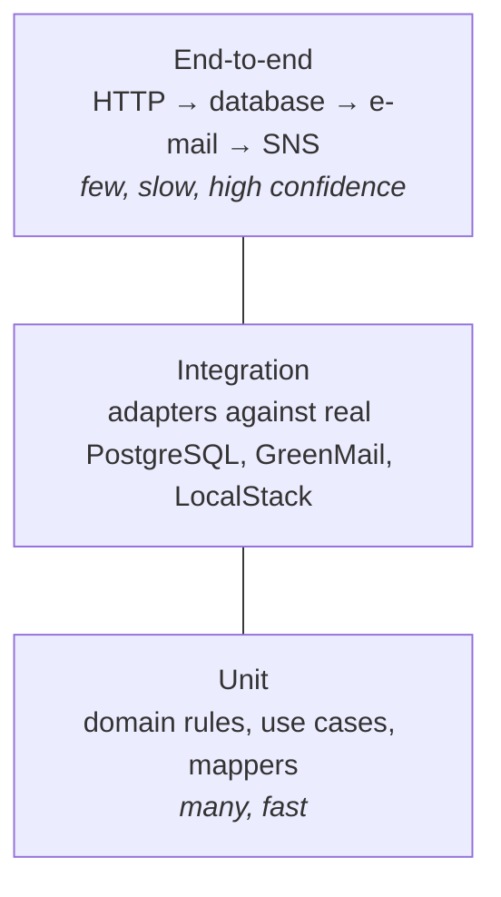

# 11. Testing

## In short

- **Unit tests** check the business rules in isolation, without a database or
  network. They are fast.
- **Integration tests** run against a **real PostgreSQL 18**, a fake mail server
  and a fake AWS, all started automatically in Docker.
- An **end-to-end test** sends a real HTTP request and checks the e-mail, the
  ledger and the audit event that reach SNS.
- **JaCoCo** measures line coverage across all modules. The build **fails below
  90 %**.
- One command runs everything: `./mvnw verify`.

## The test layers



| Layer | What it proves | Tools | Examples |
|---|---|---|---|
| **Unit** | Rules and decisions are right | JUnit, Mockito | Confidence 0–100 · message text matches the brief exactly · retry stops on permanent errors · list diff finds added and removed targets |
| **Integration** | Our code works with the real infrastructure | Testcontainers (PostgreSQL 18), GreenMail, LocalStack | Liquibase scripts run on an empty database · the same idempotency key creates one row · two workers never claim the same row · expired leases are reclaimed · audit events reach SNS in order |
| **API contract** | The HTTP API behaves as documented | Real HTTP calls to the running app (Java `HttpClient`) | `400` with field details · `202` and `duplicate = true` · limits at exactly 255 / 64 / 320 / 50 pass, one more fails · `500`/`503` never show internal messages |
| **End-to-end** | The whole feature works | All of the above | `POST` a warning letter → e-mail arrives with the exact text → ledger row → audit event on SNS |

## From acceptance criteria to tests

Every acceptance criterion in [Requirements & acceptance](02-requirements-and-acceptance.md)
has at least one test.

| Criteria | Covered by |
|---|---|
| AC-1 to AC-4 (accept, send, track, finish) | End-to-end test |
| AC-5 (list change) | API contract and persistence integration tests |
| AC-6 (metrics) | Unit test of the metrics adapter, checks in the flow test |
| AC-7, AC-8 (duplicates, invalid input) | API contract test, concurrent-insert integration test |
| AC-9, AC-10, AC-11 (retries, permanent failure) | Dispatcher unit tests, flow integration test with GreenMail failures |
| AC-12, AC-13 (crash, two instances) | Inbox integration test with an expired lease and two parallel claimers |
| AC-14 to AC-16 (no list, unknown type, Slack) | Flow integration test |
| AC-17 (SNS down) | Relay unit test with a failing broker |
| AC-18 (database down) | API contract test with a failing database |

## Test data

Tests need nothing installed except **Docker**.

- **Database:** each test run starts a fresh PostgreSQL 18 container. Liquibase
  creates the schema from scratch, exactly as in production.
- **Fixtures:** `002-seed-initial-data.sql` adds one demo distribution list
  (`demo-customer`). Every other piece of data is created by the test itself
  through the API or the ports, so each test is self-contained and readable.
- **Mail:** GreenMail runs an SMTP server inside the test and lets us read the
  e-mails it received.
- **AWS:** LocalStack provides SNS and SQS. As in production, a queue is
  subscribed to the topic; the test reads the audit events from it.
- **Time:** retry pauses use an injectable "sleeper", so tests do not wait for
  real.

## Coverage

Coverage is merged from unit and integration tests of **all modules** into one
JaCoCo report:

- Report: `../notification-boot/target/site/jacoco-aggregate/index.html`
- Rule: **line coverage ≥ 90 %**, checked during `./mvnw verify`. Below that the
  build fails.
- Excluded: code generated from the OpenAPI file (we do not write it, so testing
  it says nothing about our work).

> Coverage only shows that code was **run** by a test, not that it is
> **correct**. That is why the acceptance tests check exact results (the exact
> e-mail text, the exact audit events), not just that "something happened".

## Running the tests

```bash
./mvnw verify                          # everything, with the coverage check
./mvnw -pl notification-domain test    # one module, unit tests only
```

The same `./mvnw verify` runs on every push in GitHub Actions (Java 25).

## Rules for contributors

1. New business logic comes with unit tests.
2. Database changes come with an integration test on real PostgreSQL.
3. API changes come with a contract test for the success and the error cases.
4. Assert on **exact** outcomes, not only on "no exception".
