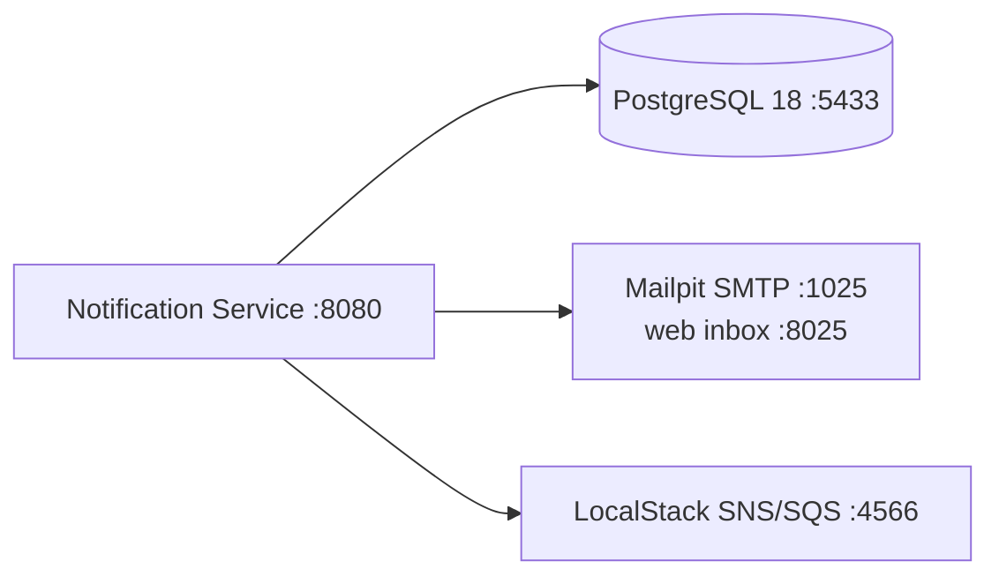

# 12. Running and operating

## In short

- Locally, one `docker compose` command starts everything the service needs:
  PostgreSQL 18, a test mail server with a web inbox, and a fake AWS.
- Every setting can be changed with an environment variable.
- The runbook at the end says what to do when something goes wrong.

## Run it locally

**You need:** Java 25 and Docker. The AWS CLI is optional (step 7).

```bash
# 1. Start the dependencies
docker compose -f _dev/docker-compose.yml down -v
docker compose -f _dev/docker-compose.yml up -d
```
```bash
# 2. Build (runs all tests)
./mvnw verify
```
```bash
# 3. Start the service
java -jar notification-boot/target/notification-boot-0.0.1-SNAPSHOT.jar
```

| What | Where |
|---|---|
| Service API | http://localhost:8080/api/v1 |
| Health check | http://localhost:8080/actuator/health |
| Metrics | http://localhost:8080/actuator/metrics |
| Mail inbox (Mailpit) | http://localhost:8025 |
| PostgreSQL | `localhost:5433`, database `notification`, user and password `postgres` |
| Fake AWS (LocalStack) | http://localhost:4566 (SNS topic `notification-audit-events`, plus a queue to read events) |



### Try it

```bash
# 4. Give a customer a distribution list
curl -X PUT localhost:8080/api/v1/customers/CUST-1/distribution-list \
  -H 'Content-Type: application/json' -H 'X-Actor: you@qualifyze.com' \
  -d '{"targets":[{"deliveryChannel":"EMAIL","notificationTarget":"qa@customer.example"}]}'
```
```bash
# 5. Send a notification
curl -X POST localhost:8080/api/v1/notifications \
  -H 'Content-Type: application/json' \
  -d '{"idempotencyKey":"try-1","messageType":"REGULATORY_EVENT",
       "siteName":"Qualifyze Spain","siteAddress":"Passeig de Gracia 19 Barcelona",
       "authorityName":"FDA","documentTypeCode":"WARNING_LETTER",
       "issueDate":"2026-06-12","confidenceLevel":80,
       "affectedCustomerReferences":["CUST-1"]}'
```
```bash
# 6. Open email client to see the e-mail
open "http://localhost:8025"
```
```bash
# 7. Read the audit events that reached "AWS"
aws --endpoint-url http://localhost:4566 sqs receive-message \
  --queue-url http://localhost:4566/000000000000/notification-audit-events \
  --max-number-of-messages 10
```

### Start from a clean database

```bash
docker compose -f _dev/docker-compose.yml down -v   # -v also deletes the data
docker compose -f _dev/docker-compose.yml up -d
```

### Troubleshooting

| Symptom | Likely cause and fix |
|---|---|
| `./mvnw verify` fails before running tests with a Testcontainers error | Docker is not running. Start it and try again. |
| `docker compose up` fails with "port is already allocated" | Another process uses 5433, 1025, 8025 or 4566. Stop it, or change the left-hand port in `_dev/docker-compose.yml` and the matching [setting](#environment-variables). |
| The service does not start: "Connection refused" to `localhost:5433` | The dependencies are not running. Run step 1. |
| No e-mail in Mailpit | Check that the customer in step 5 has a list (step 4). A customer without a list is skipped with a warning in the log. |
| `aws: command not found` in step 7 | Use LocalStack's own CLI instead: `docker exec qualifyze-notification-localstack awslocal sqs receive-message --queue-url http://localhost:4566/000000000000/notification-audit-events` |
| Strange data from earlier runs | [Start from a clean database](#start-from-a-clean-database). |

## Configuration

Every value has a sensible default for local use. In other environments, set the
environment variable. Settings live in
`notification-boot/src/main/resources/application.yaml`.

### Key numbers

#### Sending times

| What | Default | Setting | Explained in |
|---|---|---|---|
| How often the inbox is checked | 1 s | `NOTIFICATION_INBOX_WORKER_DELAY_MS` | [How it works](05-how-it-works.md#2-sending-notifications) |
| Notifications claimed per run | 50 | `NOTIFICATION_INBOX_WORKER_BATCH_SIZE` | [How it works](05-how-it-works.md#2-sending-notifications) |
| Lease on a claimed notification | 5 min | `NOTIFICATION_INBOX_WORKER_LEASE` | [Crash recovery](05-how-it-works.md#3-recovering-from-a-crash) |
| Claims before giving up (`FAILED`) | 5 | `NOTIFICATION_INBOX_WORKER_MAX_CLAIMS` | [Crash recovery](05-how-it-works.md#3-recovering-from-a-crash) |
| Tries per target | 3 | `NOTIFICATION_DISPATCH_RETRY_MAX_ATTEMPTS` | [Retries](05-how-it-works.md#retries) |
| First pause between tries (then doubles, plus jitter) | 200 ms | `NOTIFICATION_DISPATCH_RETRY_INITIAL_BACKOFF_MS` | [Retries](05-how-it-works.md#retries) |
| Mail connect / read / write time limit | 10 s | `NOTIFICATION_CHANNEL_EMAIL_TIMEOUT` | [Retries](05-how-it-works.md#retries) |

#### Audit times and retention

| What | Default | Setting | Explained in |
|---|---|---|---|
| How often audit events are forwarded | 1 s | `NOTIFICATION_AUDIT_OUTBOX_WORKER_DELAY_MS` | [Audit](08-audit-and-compliance.md#the-journey-of-an-audit-record) |
| Audit events forwarded per run | 50 | `NOTIFICATION_AUDIT_OUTBOX_WORKER_BATCH_SIZE` | [Audit](08-audit-and-compliance.md#the-journey-of-an-audit-record) |
| How often forwarded events are purged | 1 h | `NOTIFICATION_AUDIT_OUTBOX_PURGE_DELAY_MS` | [Data model](07-data-model.md#audit_outbox) |
| Forwarded events kept in our outbox | 7 days | `NOTIFICATION_AUDIT_OUTBOX_RETENTION` | [Data model](07-data-model.md#audit_outbox) |
| Events kept in the audit service's SQS queue | 14 days | Audit team | [Audit](08-audit-and-compliance.md#why-it-can-be-trusted) |
| Events kept in the archive | 7 years | Audit team | [Assumption S5](03-assumptions.md#smaller-assumptions) |

#### API limits (fixed in the contract)

| What | Limit | Explained in |
|---|---|---|
| Customers per notification | 1,000 ⚠️ (should be 50, [gap G1](09-security-threat-assessment.md#open-gaps)) | [API](06-api.md#send-a-notification) |
| Targets per distribution list | 50 | [API](06-api.md#set-a-distribution-list) |
| Idempotency key, site name, authority | 255 characters | [API](06-api.md#send-a-notification) |
| Site address | 512 characters | [API](06-api.md#send-a-notification) |
| Customer reference, document type code | 64 characters | [API](06-api.md#send-a-notification) |
| Notification target | 320 characters | [API](06-api.md#set-a-distribution-list) |
| `X-Actor` header | 128 characters | [API](06-api.md#who-is-calling) |
| Confidence level | 0–100 | [API](06-api.md#send-a-notification) |
| Error details stored per failed attempt | 1,000 characters | [Data model](07-data-model.md#dispatch_ledger) |

#### Alert thresholds (📋 proposed)

| What | Threshold | Explained in |
|---|---|---|
| Stuck notification | `DISPATCHING` for more than 10 min | [Metrics → Alerts](10-metrics.md#alerts) |
| Audit backlog | Oldest waiting event older than 5 min, or more than 1,000 waiting | [Metrics → Alerts](10-metrics.md#alerts) |

The lease must be longer than the slowest single target. With the defaults, one
target takes at most 3 tries × (10 s to connect + 10 s per read or write) plus
pauses, about 1–2 minutes, well below 5 minutes. The lease is renewed after
every target.

### Environment variables

#### Database

| Variable | Default |
|---|---|
| `SPRING_DATASOURCE_URL` | `jdbc:postgresql://localhost:5433/notification` |
| `SPRING_DATASOURCE_USERNAME` / `_PASSWORD` | `postgres` / `postgres` |

In AWS the URL points to the Aurora PostgreSQL cluster (writer) endpoint and
must turn on certificate checking, for example
`jdbc:postgresql://<cluster-endpoint>:5432/notification?sslmode=verify-full`.
The username and password come from AWS Secrets Manager, never the defaults.

#### E-mail

| Variable | Default | Meaning |
|---|---|---|
| `NOTIFICATION_CHANNEL_EMAIL_HOST` / `_PORT` | `localhost` / `1025` | SMTP server |
| `NOTIFICATION_CHANNEL_EMAIL_FROM` | `no-reply@qualifyze.local` | Sender address |
| `NOTIFICATION_CHANNEL_EMAIL_USERNAME` / `_PASSWORD` | empty | SMTP login |
| `NOTIFICATION_CHANNEL_EMAIL_AUTH` / `_STARTTLS` | `false` / `false` | Turn both on in production. ⚠️ STARTTLS cannot be made *required* yet ([gap G3](09-security-threat-assessment.md#open-gaps)). |
| `NOTIFICATION_CHANNEL_EMAIL_TIMEOUT` | `10s` | Time limit for connecting, reading and writing |

#### Sending

| Variable | Default | Meaning |
|---|---|---|
| `NOTIFICATION_INBOX_WORKER_ENABLED` | `true` | Turn the sending job off (e.g. on a read-only instance) |
| `NOTIFICATION_INBOX_WORKER_DELAY_MS` | `1000` | How often to look for waiting notifications |
| `NOTIFICATION_INBOX_WORKER_BATCH_SIZE` | `50` | How many to pick up per run |
| `NOTIFICATION_INBOX_WORKER_LEASE` | `PT5M` | After this, a stuck notification is picked up again |
| `NOTIFICATION_INBOX_WORKER_MAX_CLAIMS` | `5` | After this many pick-ups, give up and mark `FAILED` |
| `NOTIFICATION_DISPATCH_RETRY_MAX_ATTEMPTS` | `3` | Tries per target |
| `NOTIFICATION_DISPATCH_RETRY_INITIAL_BACKOFF_MS` | `200` | First pause between tries (then doubles) |

#### Audit

| Variable | Default | Meaning |
|---|---|---|
| `NOTIFICATION_AUDIT_BROKER` | `sns` | `sns`, or `logging` to just print events |
| `NOTIFICATION_AUDIT_SNS_TOPIC_ARN` | LocalStack topic | Where to publish |
| `NOTIFICATION_AUDIT_SNS_MESSAGE_GROUP_ID` | `notification-service` | FIFO message group (used when the topic name ends in `.fifo`) |
| `NOTIFICATION_AUDIT_AWS_REGION` | `us-east-1` | |
| `NOTIFICATION_AUDIT_AWS_ENDPOINT` | `http://localhost:4566` | Leave **empty** in AWS |
| `NOTIFICATION_AUDIT_AWS_ACCESS_KEY` / `_SECRET_KEY` | `test` / `test` | Leave **empty** in AWS: the service then uses its IAM role |
| `NOTIFICATION_AUDIT_OUTBOX_WORKER_ENABLED` | `true` | Turn the relay and purge jobs off |
| `NOTIFICATION_AUDIT_OUTBOX_WORKER_DELAY_MS` | `1000` | How often to forward audit events |
| `NOTIFICATION_AUDIT_OUTBOX_WORKER_BATCH_SIZE` | `50` | How many to forward per run |
| `NOTIFICATION_AUDIT_OUTBOX_PURGE_DELAY_MS` | `3600000` | How often to delete old forwarded events |
| `NOTIFICATION_AUDIT_OUTBOX_RETENTION` | `P7D` | Keep forwarded events this long |

#### Metrics

To get percentiles (p95) in Prometheus, turn on the histogram:

```yaml
management:
  endpoints.web.exposure.include: health,metrics,prometheus
  metrics.distribution.percentiles-histogram.notification.dispatch.latency: true
```

## Production checklist

Each item is a control from the
[threat assessment](09-security-threat-assessment.md#mitigation-check) that lives
outside the code (☁️) or is still a code gap (⚠️).

**Close the code gaps first** ([G1–G4](09-security-threat-assessment.md#open-gaps)):

- [ ] ⚠️ At most 50 customers per notification in the API contract (G1).
- [ ] ⚠️ `X-Actor` required on distribution-list changes (G2).
- [ ] ⚠️ SMTP fails if STARTTLS is not available (`mail.smtp.starttls.required`) (G3).
- [ ] ⚠️ The demo seed data runs only in the `local` Liquibase context (G4).

**Then confirm in each environment:**

- [ ] ☁️ Database, SMTP and AWS settings come from AWS Secrets Manager.
- [ ] ☁️ AWS keys and endpoint are **empty**, so the pod's IAM role (IRSA or EKS
      Pod Identity) is used. The role may only `sns:Publish` to the audit
      topic.
- [ ] ☁️ Pods cannot use the EKS node's IAM role: IMDSv2 is required with a hop
      limit of 1.
- [ ] ☁️ The SNS topic and the audit SQS queue are FIFO, encrypted with KMS, and
      reached through VPC endpoints.
- [ ] ☁️ Aurora: encrypted with KMS, not public, its security group only accepts
      this service's pods, TLS with `sslmode=verify-full`, its own database
      user (not the master user), snapshots encrypted and access limited.
- [ ] ☁️ SMTP authentication and STARTTLS are turned on
      (`NOTIFICATION_CHANNEL_EMAIL_AUTH`, `_STARTTLS`).
- [ ] ☁️ The service mesh enforces strict mTLS, an allow list per path
      (detection process → `POST /notifications`, BFF →
      `PUT /customers/.../distribution-list`, monitoring → `/actuator`), and
      `SANITIZE_SET` for the client certificate header.
- [ ] ☁️ Kubernetes NetworkPolicies only allow traffic through the mesh.
- [ ] 📋 The [alerts](10-metrics.md#alerts) are in place.

## Runbook

### A notification is `FAILED`

1. Find out why:
   ```sql
   SELECT customer_reference, notification_target, attempt_number, outcome, error_details, dispatched_at
   FROM   dispatch_ledger
   WHERE  idempotency_key = '<key>'
   ORDER  BY dispatched_at;
   ```
2. Fix the cause (wrong address → update the distribution list; SMTP login →
   fix the configuration).
3. Ask the caller to send the notification again with a **new** idempotency key.
   It goes to every target again.

### A customer was skipped

The `notification.customers.skipped` alert fired. The customer has no
distribution list. Ask the account owner for the addresses and set them with
`PUT /api/v1/customers/{customerReference}/distribution-list`.

### A notification stays in `DISPATCHING`

It should be picked up again once its lease (5 minutes) expires. If not:

```sql
SELECT event_reference, claimed_at, claim_count
FROM   notification_inbox
WHERE  status = 'DISPATCHING' AND claimed_at < now() - interval '10 minutes';
```

- Check that the service is running and the sending job is enabled
  (`NOTIFICATION_INBOX_WORKER_ENABLED`).
- If `claim_count` keeps rising, the notification crashes the service; it will
  be marked `FAILED` after 5 claims. Check the logs for that `event_reference`.

### The audit backlog grows

Events are not reaching SNS.

1. Check the logs for SNS errors (permissions, wrong topic, network).
2. Fix the cause. **No data is lost**: events wait in `audit_outbox` and are sent
   in order once SNS is reachable.
3. Watch `notification.audit.outbox.depth` go back to zero.

If our outbox is empty but events are missing in the archive, the problem is
after SNS: ask the audit team to check their SQS queue and its dead-letter
queue.

### The mail server is down

Deliveries fail after 3 tries and notifications become `FAILED`. Once the server
is back, resend the affected notifications with new idempotency keys (see
[A notification is `FAILED`](#a-notification-is-failed)).

---

← [11. Testing](11-testing.md) · [Docs index](README.md) · [13. Design decisions](13-design-decisions.md) →
