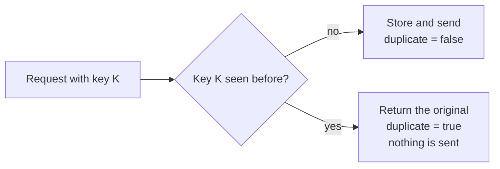

# 6. API

## In short

- Two endpoints: one to **send a notification**, one to **set a customer's
  distribution list**.
- The contract is written first in OpenAPI
  ([notification-api.yaml](../../adapter-rest-api/src/main/openapi/notification-api.yaml));
  the Java code is generated from it, so the two never disagree.
- The API is for internal services only. The service mesh checks who is calling
  before the request reaches us.

| Method | Path | What it does | Success |
|---|---|---|---|
| `POST` | `/api/v1/notifications` | Accept a notification for sending | `202 Accepted` |
| `PUT` | `/api/v1/customers/{customerReference}/distribution-list` | Replace a customer's targets | `200 OK` |

## Who is calling

The service mesh checks the calling service before the request reaches us
(see [Assumptions A5](03-assumptions.md#a5-only-internal-services-call-the-api)).

| Header | Endpoint | Set by | Meaning |
|---|---|---|---|
| `X-Actor` (optional, max 128) | Distribution list | The BFF | The **logged-in user** behind the change, e.g. `jane.doe@qualifyze.com` |

`X-Actor` is stored as the actor of every distribution-list audit event. If it
is missing, the actor is `notification-service`. Notification ingestion has no
user behind it: its audit events record `notification-api` (received) and
`system` (status changes and delivery attempts).

## Send a notification

`POST /api/v1/notifications`

The body depends on `messageType`.

### Regulatory event

```json
{
  "idempotencyKey": "7f3c2b10-5d9a-4a1e-8f2b-1c9d4e6a0b11",
  "messageType": "REGULATORY_EVENT",
  "siteName": "Qualifyze Spain",
  "siteAddress": "Passeig de Gracia 19 Barcelona",
  "authorityName": "FDA",
  "documentTypeCode": "WARNING_LETTER",
  "issueDate": "2026-06-12",
  "confidenceLevel": 80,
  "affectedCustomerReferences": ["CUST-004521", "CUST-004522"]
}
```

| Field | Rules | Notes |
|---|---|---|
| `idempotencyKey` | required, 1–255 characters | Unique per notification. A UUID is a good choice. |
| `messageType` | required | `REGULATORY_EVENT` or `CERTIFICATE_EXPIRY` |
| `siteName` | required, 1–255 | |
| `siteAddress` | required, 1–512 | |
| `authorityName` | required, 1–255 | e.g. FDA, EMA, MHRA |
| `documentTypeCode` | required, 1–64 | `WARNING_LETTER`, `OAI`, `NON_COMPLIANCE_REPORT`, or any new code |
| `issueDate` | required, `YYYY-MM-DD` | |
| `confidenceLevel` | required, whole number 0–100 | |
| `affectedCustomerReferences` | required, 1–50 unique items, each 1–64 characters | |

### Certificate expiry

A second message type, to show how new kinds of notification are added.

```json
{
  "idempotencyKey": "b1d4e2a0-…",
  "messageType": "CERTIFICATE_EXPIRY",
  "siteName": "Acme Pharma Plant 3",
  "siteAddress": "221B Baker Street, London",
  "certificateType": "GMP_CERTIFICATE",
  "issuingAuthority": "European Medicines Agency",
  "expiryDate": "2026-12-31",
  "affectedCustomerReferences": ["CUST-004521"]
}
```

### Response

```json
{
  "eventReference": "2f6a9c47-3b8e-4d2a-9c1f-8e7b5a3d2c10",
  "idempotencyKey": "7f3c2b10-5d9a-4a1e-8f2b-1c9d4e6a0b11",
  "messageType": "REGULATORY_EVENT",
  "status": "RECEIVED",
  "duplicate": false
}
```

| Field | Meaning |
|---|---|
| `eventReference` | Our ID for this notification. |
| `status` | `RECEIVED`, `DISPATCHING`, `COMPLETED` or `FAILED`. |
| `duplicate` | `true` if this idempotency key was already used. You get back the original notification and nothing new is sent. |

> **Note:** `202 Accepted` means the notification is safely stored. Sending
> happens a moment later in the background.

### Sending the same request twice



We do not compare the content of the two requests. A new notification must use a
new key.

## Set a distribution list

`PUT /api/v1/customers/{customerReference}/distribution-list`

Replaces the customer's whole list. Sending the same list twice changes nothing.

```json
{
  "targets": [
    { "deliveryChannel": "EMAIL", "notificationTarget": "qa-alerts@customer.example" },
    { "deliveryChannel": "EMAIL", "notificationTarget": "quality.head@customer.example" }
  ]
}
```

| Field | Rules |
|---|---|
| `customerReference` (in the path) | 1–64 characters |
| `targets` | at least 1 |
| `deliveryChannel` | `EMAIL` or `SLACK` |
| `notificationTarget` | 1–320 characters. For `EMAIL`, a valid e-mail address. |

`SLACK` targets are accepted but cannot be delivered yet (no Slack sender exists).

Response `200 OK`:

```json
{
  "customerReference": "CUST-004521",
  "targets": [
    { "deliveryChannel": "EMAIL", "notificationTarget": "qa-alerts@customer.example" },
    { "deliveryChannel": "EMAIL", "notificationTarget": "quality.head@customer.example" }
  ]
}
```

Every added or removed address is recorded as an audit event with the `X-Actor`
user as the actor.

## Errors

Every error has the same shape:

```json
{
  "code": "NOTIF-VAL-001",
  "reason": "VALIDATION_FAILED",
  "message": "One or more fields are invalid",
  "timestamp": "2026-10-07T03:00:00Z",
  "path": "/api/v1/notifications",
  "details": ["confidenceLevel: must be less than or equal to 100"]
}
```

| HTTP | Code | When | Should the caller retry? |
|---|---|---|---|
| `400` | `NOTIF-VAL-001` | A field is missing, too long or out of range | No, fix the request |
| `400` | `NOTIF-VAL-002` | The JSON cannot be read, or `messageType` is unknown | No, fix the request |
| `422` | `NOTIF-BIZ-001` | The request is well-formed but breaks a business rule | No, fix the request |
| `404` | `NOTIF-RES-404` | The endpoint does not exist | No, fix the URL |
| `500` | `NOTIF-INT-001` | Something unexpected went wrong on our side | Maybe later; we are alerted |
| `503` | `NOTIF-DEP-001` | The database is temporarily unavailable | Yes, with the same idempotency key |

- For `500` and `503` the `message` is always generic. Internal details are only
  written to our logs, never sent to the caller.
- There is no `401` or `403`: the service mesh rejects unknown callers before the
  request reaches us.
- There is no `409`: a repeated idempotency key is a normal `202` with
  `duplicate = true`.
- Retrying with the **same** idempotency key is always safe.

## Design rationale (canonical source)

API design choices are explained in [Design decisions](13-design-decisions.md):

- [D2. Accept now, send later](13-design-decisions.md#d2-accept-now-send-later)
- [D9. Idempotency key without a content check](13-design-decisions.md#d9-idempotency-key-without-a-content-check)
- [D10. Contract-first API](13-design-decisions.md#d10-contract-first-api)
