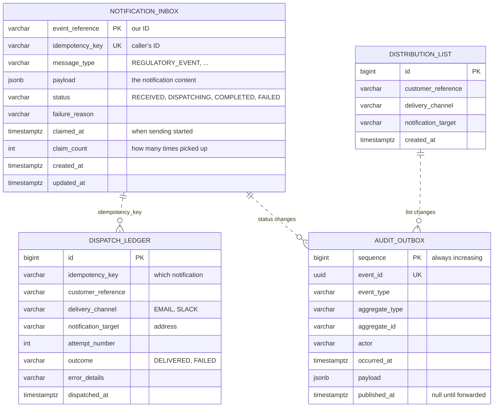
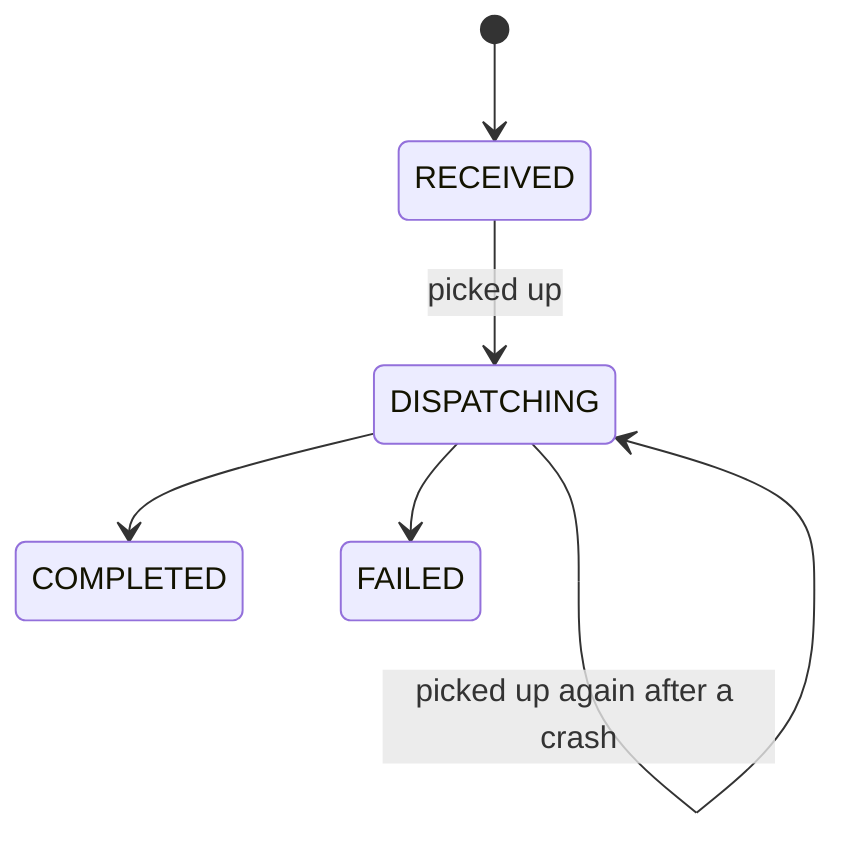

# 7. Data model

## In short

Four tables in PostgreSQL:

| Table | Holds | Kept for |
|---|---|---|
| `notification_inbox` | Each notification received and its status | Always |
| `dispatch_ledger` | Each delivery attempt | Always |
| `distribution_list` | Each customer's current targets | While they are on the list |
| `audit_outbox` | Audit events waiting to be forwarded | 7 days after forwarding |

The schema is created and changed only by **Liquibase** scripts.

## Diagram



The dotted lines are links by value, **not** foreign keys. The ledger and the
audit events must survive even if a notification is cleaned up one day, and the
outbox receives events from several tables.

## The tables

### notification_inbox

One row per notification.

- **`idempotency_key` is unique**, which is how repeats are detected.
- **`payload` is JSON** (`jsonb`). Each message type has different fields, and
  the service never searches inside them. Storing the content as JSON means a new
  message type needs **no database change**. The content is still strictly
  checked on the way in (by the API contract and the domain classes).
- `message_type` is a normal column so operators can filter by it in SQL.
- `claimed_at` and `claim_count` support crash recovery
  ([how it works](05-how-it-works.md#3-recovering-from-a-crash)).
- Index on `(status, created_at)` so finding waiting notifications stays fast.

### dispatch_ledger

One row per **attempt**, never updated or deleted. It answers questions like
"did CUST-1 get the warning about site X, and when?"

- `outcome` is `DELIVERED` or `FAILED`; `error_details` says why, cut to 1,000
  characters.
- A small index covering **only `DELIVERED` rows** makes the check
  "was this target already reached for this notification?" fast. That check is
  what prevents duplicate e-mails after a crash.

### distribution_list

One row per target currently on a customer's list.

- No two rows can have the same customer, channel and address.
- There are no "active" flags or version numbers: a removed target is simply
  deleted. The history of who added or removed it is in the audit trail.

### audit_outbox

A **waiting room** for audit events, not their permanent home.

- Written in the **same transaction** as the change it describes.
- `sequence` always increases, so the audit service can detect gaps.
- Forwarded rows get `published_at` and are deleted after 7 days.
- Two small indexes: one for "not yet forwarded" (what the relay reads) and one
  for "forwarded" (what the clean-up reads).

## The life of a notification



Only `RECEIVED` notifications, and `DISPATCHING` ones whose 5-minute lease has
expired, are picked up. This is how FR.1.4 is met: a finished notification is
never sent again.

Picking up is one SQL statement:

```sql
UPDATE notification_inbox
SET    status = 'DISPATCHING', claimed_at = now(), claim_count = claim_count + 1
WHERE  event_reference IN (
         SELECT event_reference FROM notification_inbox
         WHERE  status = 'RECEIVED'
            OR (status = 'DISPATCHING' AND claimed_at < now() - interval '5 minutes')
         ORDER  BY created_at
         LIMIT  50
         FOR UPDATE SKIP LOCKED)
RETURNING *;
```

`FOR UPDATE SKIP LOCKED` means "lock the rows I take, and ignore rows someone
else has locked". Two copies of the service can run this at the same time and
never get the same row.

## Database changes (Liquibase)

Scripts live in
`adapter-persistence-postgres/src/main/resources/db/changelog/changes/`:

| Script | What it does |
|---|---|
| `001-create-core-tables.sql` | Creates the four tables and their indexes |
| `002-seed-initial-data.sql` | Adds one demo distribution list (`demo-customer`) |
| `003-align-column-lengths.sql` | Matches column sizes to the API limits, adds the crash-recovery columns and the "delivered" index, removes unused columns |

Rules:

- A script that has run is **never edited**. Every change is a new script.
- Column sizes follow the API contract, so a request the API accepts can always
  be stored.
- New message types need no script, because their content is JSON.
- The demo data is for local use and tests. In production it would be limited to
  a `local` Liquibase context.
