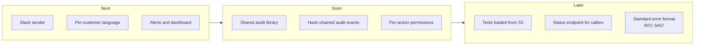

# 14. Limitations and roadmap

## In short

The service does what the brief asks. This page is honest about what it
deliberately does **not** do yet, the small risks we accepted, and what we would
build next.

## Known limitations

| Limitation | Impact | Why we accept it for now |
|---|---|---|
| A customer may very rarely get one duplicate e-mail | Only if the service crashes between the mail server accepting a message and us recording it | Avoiding it needs help from the mail provider. A duplicate is better than a missed warning. |
| A repeated idempotency key with different content is treated as a repeat | The second, different event is not sent | Callers are internal and trusted; the rule is documented. |
| Failed notifications are not retried automatically | Someone has to resend them | With 1–5 events a week, a person checking each failure is safer than blind retries. |
| Slack is accepted but cannot be delivered | Slack targets always fail | It shows the extension point. Building the sender is a small, separate task. |
| Audit events could be edited in our database for about a second before forwarding | Only by a database administrator | Very unlikely; a hash chain would close it (see roadmap). |
| Any allowed internal service can change any customer's list | Wider access than strictly needed | Normal for internal APIs; per-action permissions are on the roadmap. |
| Messages are only in English | Non-English customers get English | The texts are already in a translation file; adding a language is configuration. |
| The demo seed data runs in every environment | One demo list in production | Must be limited to a `local` Liquibase context before production. |
| Local setup uses dummy AWS keys | None locally; a risk if left in production | Production uses IAM roles; listed in the production checklist. |
| `X-Actor` is optional | A list change without it cannot be traced to a person | The BFF always sets it; making it required is a small change (see [T2](09-security-threat-assessment.md#t2-someone-fakes-the-person-in-x-actor)). |
| The API accepts up to 1,000 customers per notification | Larger bursts than the documented 50 | The contract's `maxItems` should be 50 (see [T3](09-security-threat-assessment.md#t3-harmful-or-huge-input)). |
| STARTTLS is not enforced | Mail could go unencrypted if the server does not offer TLS | Needs `mail.smtp.starttls.required` (see [T10](09-security-threat-assessment.md#t10-e-mail-read-or-changed-on-the-way)). |

## Roadmap

| Item | What | Why |
|---|---|---|
| **Slack sender** | A new `adapter-slack` module implementing `NotificationSenderPort` | First new channel (FR.1.7). |
| **Per-customer language** | A `locale` on each distribution list, used by the renderer | Customers in other countries. |
| **Alerts and dashboard** | The alerts and panels from [Metrics](10-metrics.md) | Notice failures within minutes. |
| **Shared audit library** | Move the outbox and relay into a Spring Boot starter used by every service; compare with Debezium and Spring Modulith | Same audit pipeline everywhere. |
| **Hash-chained audit events** | Each event includes a fingerprint of the previous one | Detects any edit before forwarding. |
| **Per-action permissions** | Allow only some services to change distribution lists | Least privilege. |
| **Record the calling service** | Store the mesh identity (`X-Forwarded-Client-Cert`) next to the actor in every audit event | Proves which service sent each change, not only which user it claimed. |
| **Texts loaded from S3** | Language packs updated without a release, with the built-in texts as backup | Faster wording changes. |
| **Status endpoint** | `GET /api/v1/notifications/{eventReference}` with per-target results | Callers can check delivery themselves. |
| **Standard error format** | Move to RFC 9457 `ProblemDetail` | Common format across services. |
