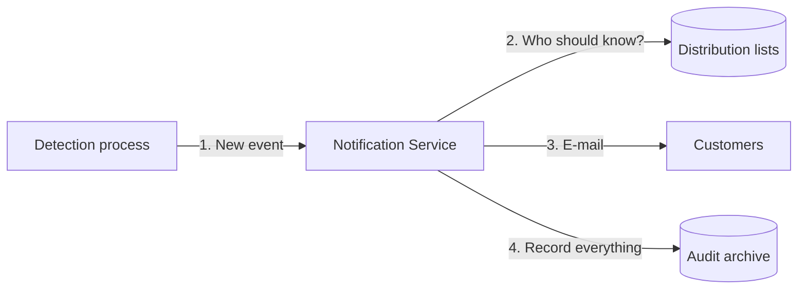

# Qualifyze Notification Service

The Notification Service tells customers when something important happens at a
manufacturing site they care about. Today that means a **regulator published a
warning letter, an OAI or a non-compliance report** about the site.

An internal process detects the event and calls this service. The service looks
up who should be told and sends each of them an e-mail like this one:

> Site Qualifyze Spain, located at Passeig de Gracia 19 Barcelona received a FDA warning letter on 12 June 2026. [80%]

Every message sent, every failure and every configuration change is recorded for
compliance.



## Quick start

You need Docker and Java 25.

```bash
docker compose -f _dev/docker-compose.yml up -d
./mvnw verify
java -jar notification-boot/target/notification-boot-0.0.1-SNAPSHOT.jar
```

For the full local walkthrough (including sample API calls, Mailpit, LocalStack,
clean reset, and troubleshooting), see
[Running and operating](12-running-and-operating.md).

## Where to start reading

| If you are… | Read |
|---|---|
| **Reviewing the challenge** | [Overview](01-overview.md) → [Requirements & acceptance](02-requirements-and-acceptance.md) → [Assumptions](03-assumptions.md) → [Design decisions](13-design-decisions.md) |
| **A developer** | [Architecture](04-architecture.md) → [How it works](05-how-it-works.md) → [API](06-api.md) → [Data model](07-data-model.md) → [Testing](11-testing.md) |
| **Security or compliance** | [Audit & compliance](08-audit-and-compliance.md) → [Security threats](09-security-threat-assessment.md) |
| **Operating the service** | [Running & operating](12-running-and-operating.md) → [Metrics](10-metrics.md) |

## Documentation rule (single source of truth)

If a concept already has a canonical page, link to it instead of repeating it.
