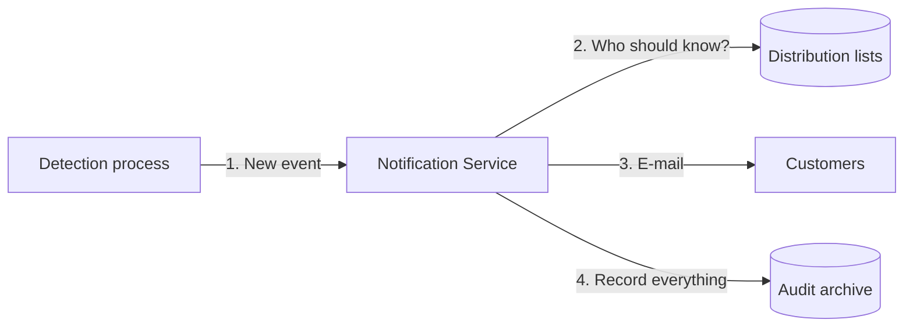

# Qualifyze Notification Service

The Notification Service tells customers when something important happens at a
manufacturing site they care about. Today that means a **regulator published a
warning letter, an OAI or a non-compliance report** about the site.

An internal process detects the event and calls this service. The service looks
up who should be told and sends each of them an e-mail like this one:

> Site Qualifyze Spain, located at Passeig de Gracia 19 Barcelona received a FDA warning letter on 12 June 2026. [80%]

Every message sent, every failure and every configuration change is recorded for
compliance.



## Quick start

You need Docker and Java 25.

```bash
# 1. Start PostgreSQL, a fake mail server and a fake AWS
docker compose -f _dev/docker-compose.yml down -f
docker compose -f _dev/docker-compose.yml up -d
```
```bash
# 2. Build, test and run the service
./mvnw verify
java -jar notification-boot/target/notification-boot-0.0.1-SNAPSHOT.jar
```
```bash
# 3. Send a notification
curl -X POST localhost:8080/api/v1/notifications \
  -H 'Content-Type: application/json' \
  -d '{
        "idempotencyKey": "demo-1",
        "messageType": "REGULATORY_EVENT",
        "siteName": "Qualifyze Spain",
        "siteAddress": "Passeig de Gracia 19 Barcelona",
        "authorityName": "FDA",
        "documentTypeCode": "WARNING_LETTER",
        "issueDate": "2026-06-12",
        "confidenceLevel": 80,
        "affectedCustomerReferences": ["demo-customer"]
      }'
```
```bash
# 4. See the e-mail at http://localhost:8025
open "http://localhost:8025"
```

More detail is in [Running and operating](12-running-and-operating.md).

## Where to start reading

| If you are… | Read |
|---|---|
| **Reviewing the challenge** | [Overview](01-overview.md) → [Requirements & acceptance](02-requirements-and-acceptance.md) → [Assumptions](03-assumptions.md) → [Design decisions](13-design-decisions.md) |
| **A developer** | [Architecture](04-architecture.md) → [How it works](05-how-it-works.md) → [API](06-api.md) → [Data model](07-data-model.md) → [Testing](11-testing.md) |
| **Security or compliance** | [Audit & compliance](08-audit-and-compliance.md) → [Security threats](09-security-threat-assessment.md) |
| **Operating the service** | [Running & operating](12-running-and-operating.md) → [Metrics](10-metrics.md) |

## All documents

| # | Document | In one sentence |
|---|---|---|
| 01 | [Overview](01-overview.md) | What problem we solve, for whom, and what is out of scope. |
| 02 | [Requirements & acceptance](02-requirements-and-acceptance.md) | Each requirement, how we meet it, and how we prove it works. |
| 03 | [Assumptions](03-assumptions.md) | What we assumed where the brief was unclear, and what changes if we are wrong. |
| 04 | [Architecture](04-architecture.md) | The building blocks and how to add new channels or message types. |
| 05 | [How it works](05-how-it-works.md) | Step-by-step flows, from receiving a request to the e-mail. |
| 06 | [API](06-api.md) | Endpoints, examples, limits and errors. |
| 07 | [Data model](07-data-model.md) | The four tables and how they change over time. |
| 08 | [Audit & compliance](08-audit-and-compliance.md) | What we record, where, and why it can be trusted. |
| 09 | [Security threats](09-security-threat-assessment.md) | What could go wrong and how we prevent it. |
| 10 | [Metrics](10-metrics.md) | Adoption and performance numbers, and when to alert. |
| 11 | [Testing](11-testing.md) | How the service is tested and how coverage is measured. |
| 12 | [Running & operating](12-running-and-operating.md) | Setup, configuration and what to do when things go wrong. |
| 13 | [Design decisions](13-design-decisions.md) | The main choices, the alternatives, and why. |
| 14 | [Limitations & roadmap](14-limitations-and-roadmap.md) | What is not done yet and what comes next. |

## Brief checklist

| The brief asks for | Where |
|---|---|
| Basic technical documentation | 01, 04, 05, 06, 07 |
| Security threat assessment | [09](09-security-threat-assessment.md) |
| Adoption and performance metrics | [10](10-metrics.md) |
| Java 25, Spring Boot 4, Liquibase 5, PostgreSQL 18 | [04](04-architecture.md#technology) |
| Test data for a clean environment | [11](11-testing.md#test-data) |
| Over 90 % coverage with JaCoCo | [11](11-testing.md#coverage) |
| Acceptance criteria: happy paths and edge cases | [02](02-requirements-and-acceptance.md#acceptance-criteria) |
| Explicit assumptions | [03](03-assumptions.md) |
| Design justification | [13](13-design-decisions.md) |
