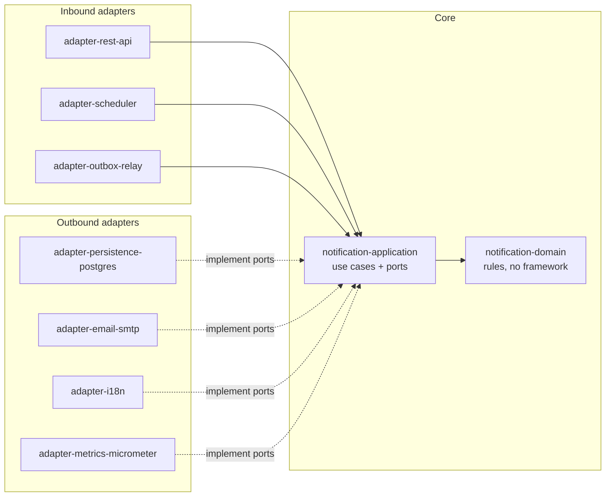
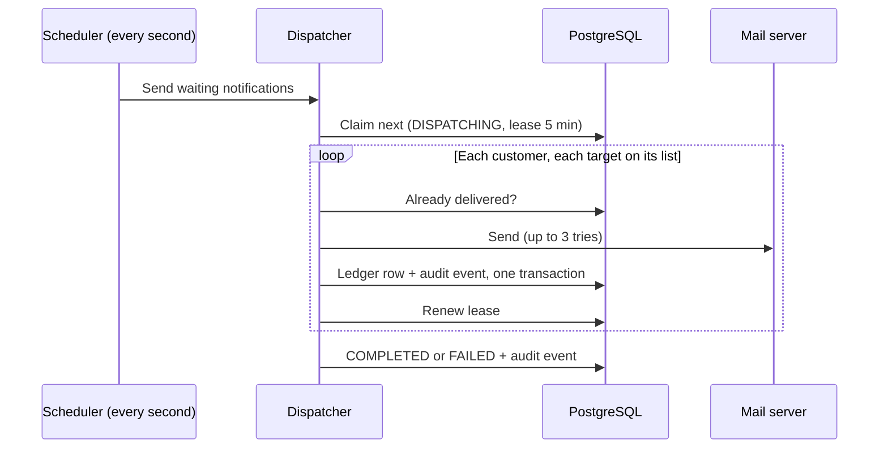
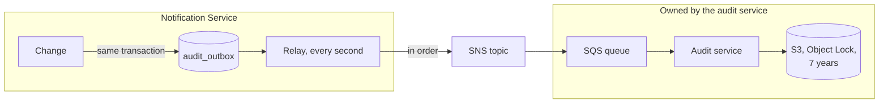

# 2. Design

The guiding rule: **keep it clean and easy to extend, but build no machinery
that 5 events a week do not need.**

## Stack

Java 25 · Spring Boot 4 · Liquibase 5 · PostgreSQL 18 (Aurora PostgreSQL in
AWS) · OpenAPI 3 with generated interfaces · Spring Mail (SMTP) · AWS SDK v2
(SNS) · Micrometer · JUnit, Testcontainers, GreenMail, LocalStack, JaCoCo.

## Architecture

The business rules sit in the middle and know only interfaces (*ports*). Web,
database, mail, AWS and metrics plug in around them (*hexagonal*, or *ports and
adapters*). Each adapter is its own Maven module, so the compiler stops business
code from using the database or the mail library directly.

`notification-boot` wires the modules together and holds the end-to-end tests.

## API

Two endpoints. The contract is
[`notification-api.yaml`](../../adapter-rest-api/src/main/openapi/notification-api.yaml).

| Method and path | What it does | Success |
|---|---|---|
| `POST /api/v1/notifications` | Accept a notification. `messageType` selects the body: `REGULATORY_EVENT` or `CERTIFICATE_EXPIRY`. | `202` with `eventReference`, `status`, `duplicate` |
| `PUT /api/v1/customers/{customerReference}/distribution-list` | Replace a customer's targets. The BFF sends the user in `X-Actor`. | `200` with the new list |

Errors share one JSON shape (`code`, `reason`, `message`, `details`). `400` for
invalid input, `422` for broken business rules, `503` when the database is down
(retry with the same key), `500` otherwise. `500` and `503` never show internal
details. There is no `401`/`403`: the mesh rejects unknown callers first.

## How it works

### 1. Receive

The API validates the request and stores it in `notification_inbox` with one
statement, `INSERT … ON CONFLICT (idempotency_key) DO NOTHING`. Two identical
requests arriving at the same moment still create one row. `202` means "safely
stored", not "delivered".

### 2. Send

- The message is built once per notification from a translation file. Known
  document codes get a label ("warning letter"); unknown ones are made readable.
- A customer without a list is skipped and counted. One failing target never
  stops the others.
- **Retries:** at most 3 tries per target, with a pause that doubles (200 ms,
  400 ms) plus jitter. Errors that cannot fix themselves (bad login, bad
  address) are not retried. Every mail call has a 10 s time limit.

### 3. Recover from a crash

A claim is a **lease**. If the service dies mid-send, the row stays
`DISPATCHING`; after 5 minutes any instance can claim it again and skips targets
the ledger already shows as delivered. A row claimed more than 5 times keeps
crashing the service, so it is marked `FAILED`. Claiming uses
`FOR UPDATE SKIP LOCKED`, so two instances never take the same row.

### 4. Record (audit)

Every change (received, status change, delivery attempt, list target added or
removed) writes an audit event **in the same transaction** as the change. A
relay publishes waiting events to SNS in order, marks them forwarded, and
deletes them 7 days later. Each event has an increasing `sequence` and a unique
ID, so the audit service can spot gaps and duplicates. If SNS is down, events
simply wait.

## Data

Four tables, created only by Liquibase scripts.

| Table | Holds |
|---|---|
| `notification_inbox` | Each notification: status, lease, and its content as `jsonb` |
| `dispatch_ledger` | Each delivery attempt, never updated: who, when, channel, outcome, error |
| `distribution_list` | Each customer's current targets (unique per customer, channel, address) |
| `audit_outbox` | Audit events waiting to be forwarded |

## Extending it (FR.1.7)

- **A new channel** (open list, each with its own library): add the value to
  `DistributionChannel` and a module implementing `NotificationSenderPort`.
  Nothing in the core changes.
- **A new message type** (closed list we own): add a record to the sealed
  `NotificationPayload` family. Every `switch` over it stops compiling until the
  new type is handled, so the compiler lists every place to update. No database
  change is needed, because content is JSON. `CERTIFICATE_EXPIRY` was added this
  way.

## Decisions

| Decision | Alternatives considered | What we accept in return |
|---|---|---|
| **Hexagonal, one Maven module per adapter** | One module with packages; classic layers | More structure than ~5,000 lines strictly need. The extension points the brief asks for map one-to-one onto modules, and the compiler enforces the boundaries. |
| **Accept now, send later** (inbox table + scheduler) | Send during the request; Kafka/SQS for input | The caller does not see the delivery result. A broker is too much for 5 events a week. |
| **Transactional outbox to a central archive** | Audit table in our own DB (we could rewrite our own history); publish straight to SNS (an outage loses events or fails changes); Debezium, Spring Modulith | The archive copy lags about a second. |
| **Dispatch ledger next to the audit trail** | Ask the archive "already delivered?" | The same facts in two places, but one runs the service and the other proves what happened. |
| **Sealed message types, plug-in channels** | Plug-in registries for both | A forgotten case fails the build instead of production. |
| **Content as JSON** | A table per message type; one wide table | The database does not check fields inside the JSON; the API contract and domain classes do. |
| **Lease-based claiming with `SKIP LOCKED`** | Optimistic locking (cannot recover from a crash); a lock service | One hand-written SQL statement. Mail calls need time limits so a target always finishes within the lease. |
| **A 20-line retry loop** | Resilience4j | If we need a circuit breaker later, we add the library. |
| **Idempotency key without content check** | Fingerprint the content and answer `409` | A caller reusing a key by mistake gets the old result. Fine for trusted callers. |
| **Contract-first OpenAPI** | Hand-written controllers and docs | Generated classes are a little clumsy (not sealed). |

**Not built on purpose:** a Slack sender (extension point is ready),
authentication in the app (the mesh does it), our own audit archive, open/click
tracking (privacy).

## Known limitations

| Limitation | Next step |
|---|---|
| Failed notifications are not retried automatically | With 1–5 events a week, a person resends with a new key. |
| A DB administrator could edit an audit event in the second before it is forwarded | Hash-chain the events. |
| `X-Actor` is optional; a list change without it is recorded as `notification-service` | Make the header required. |
| The contract allows 1,000 customers per notification; 50 is the intended limit | Set `maxItems: 50`. |
| STARTTLS to the mail server is opportunistic | Set `mail.smtp.starttls.required`. |
| The demo seed data runs in every environment | Limit it to a `local` Liquibase context. |
| Messages are English only | Add a language per customer list. |
