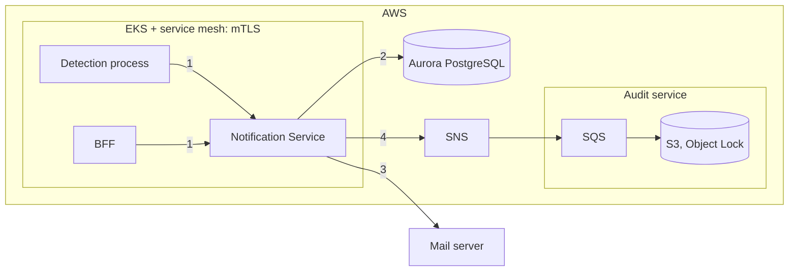

# 3. Security threat assessment

The service is internal and runs in AWS (assumption
[A9](01-requirements-and-assumptions.md#assumptions)). The main risks are
sending a warning to the **wrong person**, **losing or altering** the audit
trail, and **leaking** customer contacts.

## What we protect

| Asset | Why it matters |
|---|---|
| Distribution lists | Customer e-mail addresses are personal data. |
| Notification content | Links between sites and customers are commercially sensitive. |
| Audit trail | Proof for ISO 27001 / SOC 2. |
| Credentials and the pod's AWS identity | Give access to all of the above. |

## Trust boundaries

1. **Callers → service:** is the caller who it claims to be, and may it call
   this endpoint?
2. **Service → database:** who else can read or change the data?
3. **Service → mail server:** the only hop that leaves AWS.
4. **Service → audit path:** can events be lost, faked or changed?

## Threats (STRIDE)

| # | Threat | Type | Risk | Prevented by | Remaining risk |
|---|---|---|---|---|---|
| T1 | A service pretends to be an allowed caller, or calls an endpoint it should not | S, E | Medium | Strict mTLS in the mesh; an allow list per path (detection → `POST /notifications`, BFF → `PUT …/distribution-list`); the mesh overwrites `X-Forwarded-Client-Cert` (`SANITIZE_SET`). | A compromised allowed service can act for every customer. Per-user rights live in the BFF. |
| T2 | Someone fakes the person in `X-Actor` | S, R | Medium | Only the BFF reaches the list endpoint, and it sets `X-Actor` from its logged-in user. | Attribution, not proof. The header is optional today. |
| T3 | Harmful or huge input | T, D | Medium | Type, length and range checks before anything is stored; e-mail syntax check; parameterised SQL only; plain-text e-mails. | The contract allows 1,000 customers per notification; should be 50. |
| T4 | Warning sent to the wrong person | I | Medium | Recipients come **only** from stored lists; no list means skip, never guess. Every list change records who made it. | A wrongly typed address; the audit trail shows who added it. |
| T5 | Audit trail lost or altered | T, R | Medium | Event written in the same transaction as the change; increasing sequence numbers reveal gaps; SQS holds events while the audit service is down; S3 Object Lock; this service can only `sns:Publish`. | A DB administrator could edit an event in the second before it is forwarded (hash chain on the roadmap). |
| T6 | Customer data leaks in errors, logs, metrics or backups | I | Medium | Generic `500`/`503` messages; no personal data in metrics; error details cut to 1,000 characters; Aurora, SNS and SQS encrypted, private, TLS to the database. | Addresses are in the ledger and audit events because FR.1.6 requires it; access must stay limited. |
| T7 | Mail server outage overloads or blocks the service | D | Low | 3 tries with backoff; no retry on permanent errors; 10 s time limit per mail call; 5 claims max; sending runs in the background. | Low. |
| T8 | Stolen credentials or AWS identity | E | Medium | No secrets in code; secrets from AWS Secrets Manager; an IAM role per service account (no stored keys) limited to publishing on one topic; pods cannot use the node's role (IMDSv2, hop limit 1). | Local defaults (`postgres`, `test` keys) must be overridden in every real environment. |
| T9 | The same request is replayed | T | Low | Idempotency key with a unique index: a repeat returns the original and sends nothing. | A replay with a new key is a new notification; only the detection process may send one. |
| T10 | E-mail read or changed on the way | I, T | Medium | SMTP login and STARTTLS in production. | STARTTLS is opportunistic; it should be required. |

## Before production

- **Code:** require `X-Actor`, cap customers per notification at 50, require
  STARTTLS, run the demo seed data only locally.
- **Platform:** confirm the mesh rules (strict mTLS, per-path allow list,
  `SANITIZE_SET`), the IAM role and IMDSv2, Aurora encryption and TLS, and the
  alerts in [Metrics](04-metrics.md#alerts).
