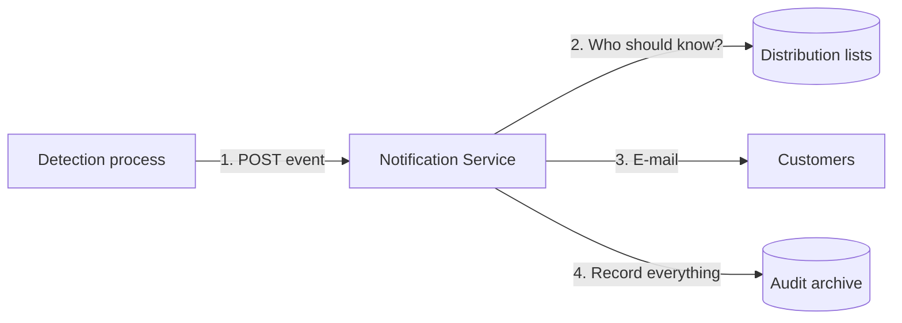

# Qualifyze Notification Service

When a regulator publishes a **warning letter, an OAI or a non-compliance
report** about a manufacturing site, the existing detection process calls this
service. The service e-mails every address on each affected customer's
distribution list:

> Site Qualifyze Spain, located at Passeig de Gracia 19 Barcelona received a FDA warning letter on 12 June 2026. [80%]

Every send, every failure and every distribution-list change is recorded for
ISO 27001 / SOC 2.



## Quick start

You need Docker and Java 25.

```bash
docker compose -f _dev/docker-compose.yml up -d      # PostgreSQL 18, Mailpit, LocalStack
./mvnw verify                                        # build, all tests, coverage check
java -jar notification-boot/target/notification-boot-0.0.1-SNAPSHOT.jar

curl -X POST localhost:8080/api/v1/notifications -H 'Content-Type: application/json' -d '{
  "idempotencyKey": "demo-1", "messageType": "REGULATORY_EVENT",
  "siteName": "Qualifyze Spain", "siteAddress": "Passeig de Gracia 19 Barcelona",
  "authorityName": "FDA", "documentTypeCode": "WARNING_LETTER",
  "issueDate": "2026-06-12", "confidenceLevel": 80,
  "affectedCustomerReferences": ["demo-customer"] }'

open http://localhost:8025                           # the e-mail, in Mailpit
```

`demo-customer` comes from the seed data. Use
`PUT /api/v1/customers/{customerReference}/distribution-list` to add others.

## What the brief asks for, and where it is

| The brief asks for | Where |
|---|---|
| Explicit assumptions | [Requirements & assumptions](01-requirements-and-assumptions.md#assumptions) |
| Acceptance criteria: happy paths and edge cases | [Requirements & assumptions](01-requirements-and-assumptions.md#acceptance-criteria) |
| Design with justification | [Design](02-design.md) |
| Security threat assessment | [Security](03-security-threat-assessment.md) |
| Adoption and performance metrics | [Metrics](04-metrics.md) |
| Java 25, Spring Boot 4, Liquibase 5, PostgreSQL 18 | [Design](02-design.md#stack) |
| Test data for a clean environment, > 90 % coverage with JaCoCo | [Testing](05-testing.md) |

## Reading order

About 15 minutes in total.

1. [Requirements & assumptions](01-requirements-and-assumptions.md): how each
   requirement is met, what we assumed, and how we prove it works.
2. [Design](02-design.md): the architecture, the main flows and the decisions
   behind them.
3. [Security threat assessment](03-security-threat-assessment.md)
4. [Metrics](04-metrics.md)
5. [Testing](05-testing.md)

The API contract is
[`notification-api.yaml`](../../adapter-rest-api/src/main/openapi/notification-api.yaml);
the Java interfaces are generated from it.
